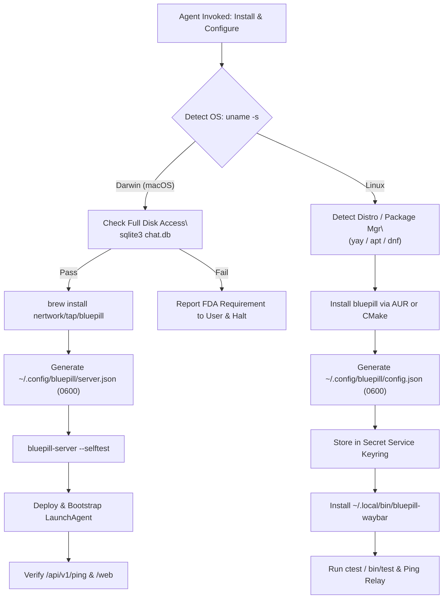

# 🤖 BluePill Autonomous Agent Operations & Installation Guide

This file provides direct operational instructions for autonomous AI coding agents (**Claude Code**, **OpenCode**, **Gemini CLI**, **Codex**, **Cursor**, **Antigravity**) interacting with the `bluepill` repository.

When an end-user prompts an agent with:
> *"Install and configure BluePill on my Mac and Linux desktop"*  
> *"Set up the BluePill relay server on this Mac"*  
> *"Verify my BluePill connection and database health"*

The agent MUST follow the non-interactive workflows detailed below.

---

## 1. Operating Rules for AI Agents

1. **Non-Interactive Execution:**
   - Always append `</dev/null` to commands to prevent blocking on interactive stdin prompts.
   - Use non-interactive CLI flags (`--noconfirm`, `-y`, `--quiet`).
2. **Explicit Timeouts:**
   - Always wrap execution in command timeouts:
     - Inspection / Status: `timeout 10s ...`
     - Network / Downloads: `timeout 60s curl ...`
     - Compilation / Builds: `timeout 300s make ...`
3. **Zero PII & Credential Masking:**
   - Never output real personal phone numbers, names, or real email addresses to stdout.
   - Use standardized test handles: `+15555550100`, `user@example.com`.
   - Never expose live tokens or passwords. Output `[REDACTED]` or placeholders (`CHANGE_ME_TO_A_SECURE_TOKEN`).
4. **Idempotence & Strict Permissions:**
   - Verify before writing configuration files.
   - Enforce `0600` permissions on files containing passwords (`~/.config/bluepill/*.json`).

---

## 2. Autonomous Installation Playbook



### Phase 1: Environment & Role Detection

Execute this snippet first to determine the host role:

```bash
OS_TYPE=$(uname -s)
ARCH_TYPE=$(uname -m)
echo "HOST_ROLE_DETECTION: OS=${OS_TYPE} ARCH=${ARCH_TYPE}"
```

- If `OS_TYPE == "Darwin"`: Run **Phase 2 (macOS Relay)**.
- If `OS_TYPE == "Linux"`: Run **Phase 3 (Linux Desktop)**.

---

### Phase 2: macOS Relay Host Installation

```bash
# 2.1 Verify Full Disk Access (FDA)
if ! timeout 10s sqlite3 "${HOME}/Library/Messages/chat.db" "SELECT count(*) FROM chat;" </dev/null >/dev/null 2>&1; then
    echo "ERROR: Full Disk Access (FDA) is missing for Terminal/Python."
    echo "Action required: Open System Settings -> Privacy & Security -> Full Disk Access and add Terminal / Python."
    exit 1
fi
echo "[✓] Full Disk Access verified."

# 2.2 Install via Homebrew
timeout 120s brew tap nertwork/tap </dev/null
timeout 120s brew install nertwork/tap/bluepill </dev/null

# 2.3 Generate ~/.config/bluepill/server.json
mkdir -p "${HOME}/.config/bluepill"
chmod 700 "${HOME}/.config/bluepill"

CONFIG_FILE="${HOME}/.config/bluepill/server.json"
if [[ ! -f "$CONFIG_FILE" ]]; then
    GEN_PWD=$(python3 -c "import secrets; print(secrets.token_hex(16))")
    cat << EOF_CFG > "${CONFIG_FILE}"
{
  "host": "0.0.0.0",
  "port": 1234,
  "password": "${GEN_PWD}",
  "helperPort": 45670,
  "enableBackgroundDaemons": true
}
EOF_CFG
    chmod 600 "${CONFIG_FILE}"
fi

# 2.4 Run Server Self-Test
timeout 15s bluepill-server --selftest </dev/null

# 2.5 Deploy LaunchAgent
PLIST="${HOME}/Library/LaunchAgents/com.nertwork.bluepill-server.plist"
BIN_PATH="$(which bluepill-server)"
PORT=$(jq -r '.port // 1234' "${CONFIG_FILE}")
PWD=$(jq -r '.password // ""' "${CONFIG_FILE}")

mkdir -p "${HOME}/Library/LaunchAgents"
cat << EOF_PL > "${PLIST}"
<?xml version="1.0" encoding="UTF-8"?>
<!DOCTYPE plist PUBLIC "-//Apple//DTD PLIST 1.0//EN" "http://www.apple.com/DTDs/PropertyList-1.0.dtd">
<plist version="1.0">
<dict>
    <key>Label</key>
    <string>com.nertwork.bluepill-server</string>
    <key>ProgramArguments</key>
    <array>
        <string>${BIN_PATH}</string>
        <string>serve</string>
        <string>--port</string>
        <string>${PORT}</string>
        <string>--password</string>
        <string>${PWD}</string>
    </array>
    <key>RunAtLoad</key>
    <true/>
    <key>KeepAlive</key>
    <true/>
    <key>StandardOutPath</key>
    <string>/tmp/bluepill-server.log</string>
    <key>StandardErrorPath</key>
    <string>/tmp/bluepill-server.err</string>
    <key>ProcessType</key>
    <string>Interactive</string>
</dict>
</plist>
EOF_PL

launchctl bootout "gui/$(id -u)/com.nertwork.bluepill-server" 2>/dev/null || true
timeout 10s launchctl bootstrap "gui/$(id -u)" "${PLIST}" </dev/null
sleep 2

# 2.6 Verify Relay Health
timeout 5s curl -s -f "http://127.0.0.1:${PORT}/api/v1/ping?password=${PWD}" </dev/null
echo "[✓] macOS Relay Server successfully deployed and running."
```

---

### Phase 3: Linux Desktop Client Installation

```bash
# 3.1 Install Desktop Client
if command -v yay >/dev/null 2>&1; then
    timeout 300s yay -S --noconfirm bluepill </dev/null
elif command -v paru >/dev/null 2>&1; then
    timeout 300s paru -S --noconfirm bluepill </dev/null
elif command -v apt-get >/dev/null 2>&1; then
    sudo apt-get update
    sudo apt-get install -y build-essential cmake ninja-build qt6-base-dev qt6-declarative-dev qt6-quickcontrols2-5-dev qt6-svg-dev qt6-wayland-dev libsecret-1-dev libnotify-dev ffmpeg
    BUILD_DIR=$(mktemp -d /tmp/bluepill-build-XXXXXX)
    git clone https://github.com/nertwork/bluepill.git "${BUILD_DIR}"
    cd "${BUILD_DIR}"
    cmake -B build -DCMAKE_BUILD_TYPE=Release -GNinja
    cmake --build build -j$(nproc)
    sudo cmake --install build
    sudo ln -sf /usr/local/bin/bluepill /usr/local/bin/imsg
    rm -rf "${BUILD_DIR}"
fi

# 3.2 Configure Client State
CLIENT_DIR="${HOME}/.config/bluepill"
mkdir -p "${CLIENT_DIR}"
chmod 700 "${CLIENT_DIR}"

CLIENT_CFG="${CLIENT_DIR}/config.json"
RELAY_URL="${BLUEPILL_RELAY_URL:-http://127.0.0.1:1234}"
RELAY_TOKEN="${BLUEPILL_RELAY_TOKEN:-CHANGE_ME_TO_A_SECURE_TOKEN}"

cat << EOF_CC > "${CLIENT_CFG}"
{
  "serverUrl": "${RELAY_URL}",
  "secondaryServerUrl": "",
  "password": "${RELAY_TOKEN}",
  "authMethod": "tls-apikey",
  "syncDays": 90
}
EOF_CC
chmod 600 "${CLIENT_CFG}"

# 3.3 Register in Secret Service Keyring (if available)
if command -v secret-tool >/dev/null 2>&1; then
    printf "%s" "${RELAY_TOKEN}" | secret-tool store --label="BluePill Relay Password" service bluepill username relay
fi

# 3.4 Deploy Waybar Notification Script
mkdir -p "${HOME}/.local/bin"
cat << 'EOF_WB' > "${HOME}/.local/bin/bluepill-waybar"
#!/usr/bin/env bash
set -euo pipefail
STATE_FILE="${HOME}/.config/bluepill/state.json"
[[ ! -f "$STATE_FILE" ]] && STATE_FILE="${HOME}/.config/imsg/state.json"
if [[ ! -f "$STATE_FILE" ]]; then
    echo '{"text": "", "alt": "disconnected", "tooltip": "BluePill: Disconnected", "class": "disconnected"}'
    exit 0
fi
UNREAD=$(jq -r '.unreadCount // 0' "$STATE_FILE" 2>/dev/null || echo 0)
CONNECTED=$(jq -r '.connected // false' "$STATE_FILE" 2>/dev/null || echo false)
if [[ "$CONNECTED" != "true" ]]; then
    echo '{"text": "󰍡 !", "alt": "offline", "tooltip": "BluePill: Offline", "class": "offline"}'
elif [[ "$UNREAD" -gt 0 ]]; then
    echo "{\"text\": \"󰍡 ${UNREAD}\", \"alt\": \"unread\", \"tooltip\": \"${UNREAD} unread message(s)\", \"class\": \"unread\", \"count\": ${UNREAD}}"
else
    echo '{"text": "󰍡", "alt": "read", "tooltip": "BluePill: Connected", "class": "read"}'
fi
EOF_WB
chmod +x "${HOME}/.local/bin/bluepill-waybar"

echo "[✓] Linux Desktop Client configured."
```

---

### Phase 4: Autonomous Diagnostic & Verification Loop

Run this verification block to report final status:

```bash
RELAY_ADDR="${BLUEPILL_RELAY_URL:-http://127.0.0.1:1234}"
RELAY_PWD="${BLUEPILL_RELAY_TOKEN:-CHANGE_ME_TO_A_SECURE_TOKEN}"

# 1. Ping
PING_OK=$(timeout 5s curl -s -f "${RELAY_ADDR}/api/v1/ping?password=${RELAY_PWD}" </dev/null | grep -q "pong" && echo true || echo false)

# 2. Web UI
WEB_OK=$(timeout 5s curl -s -o /dev/null -w "%{http_code}" "${RELAY_ADDR}/web" </dev/null | grep -q "200" && echo true || echo false)

# 3. Chat Query
CHAT_OK=$(timeout 5s curl -s -f -X POST "${RELAY_ADDR}/api/v1/chat/query?password=${RELAY_PWD}" -H "Content-Type: application/json" -d '{"limit":1}' </dev/null | grep -q "\"status\":200" && echo true || echo false)

# 4. iCloud Hub Preflight
PREFLIGHT_OK=$(timeout 5s curl -s -f "${RELAY_ADDR}/api/v1/icloud/preflight?password=${RELAY_PWD}" </dev/null | python3 -c 'import sys, json; data = json.load(sys.stdin).get("data", {}); mods = data.get("modules", {}); sys.exit(0 if mods and all(m.get("dbReadable") is True for m in mods.values() if m.get("enabled", True)) else 1)' && echo true || echo false)

echo "VERIFICATION_SUMMARY: PING=${PING_OK} WEB_UI=${WEB_OK} CHAT_QUERY=${CHAT_OK} PREFLIGHT=${PREFLIGHT_OK}"
```

---

## 3. Related Documentation

- Complete Reference: [INSTALLATION_AND_OPERATIONS_GUIDE.md](docs/INSTALLATION_AND_OPERATIONS_GUIDE.md)
- Playbook Checklist: [AGENT_INSTALL_PLAYBOOK.md](docs/AGENT_INSTALL_PLAYBOOK.md)
- Configuration & CLI: [CONFIGURATION_AND_CLI.md](docs/CONFIGURATION_AND_CLI.md)
- Architecture: [ARCHITECTURE.md](docs/ARCHITECTURE.md)
