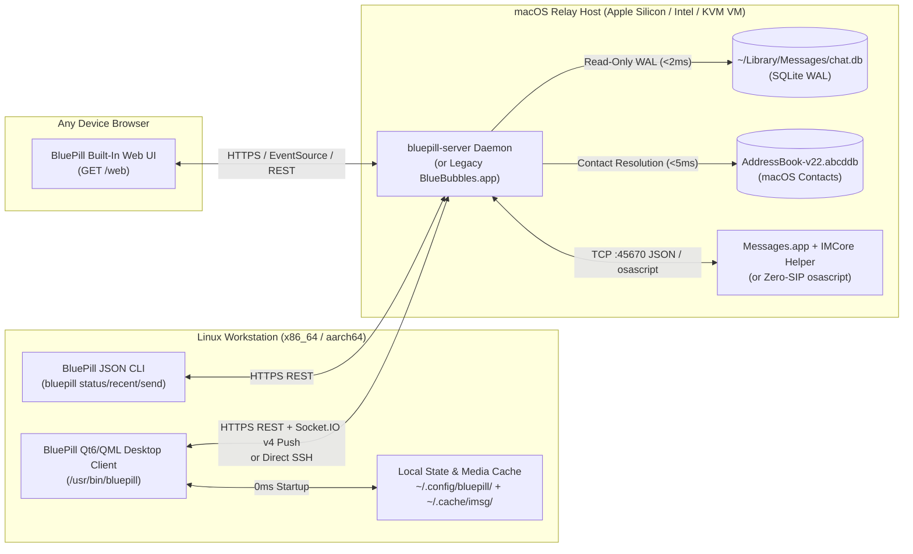

# BluePill Architecture & Internals

## 1. Linux & Windows Desktop Client (`src/backend.{h,cpp}`, `src/spellchecker.{h,cpp}`, `src/Main.qml`)
- **Zero-Latency Startup (`messages_cache.json`) & Single-Instance Tray Lifecycle:** Loads up to 500 cached messages per conversation from disk before the first network packet is sent. Closing the window minimizes to the system tray (`minimizeToTrayOnClose: true`, `Ctrl+Q` to quit), secondary launches wake and raise the existing window, and desktop notification clicks focus the target thread.
- **Isolated Network Pools (`m_nam`, `m_sendNam`, `m_mediaNam`, `m_socketNam`):** User mutations (`sendMessage`, `sendAttachments`, `sendReaction`, `markChatRead`, `createGroupChat`) execute on a dedicated high-priority `QNetworkAccessManager` (`m_sendNam`) so background image downloads on `m_mediaNam` (`?force=false`, max 2 concurrent) can never stall outbound messages.
- **Service Resolution (iMessage / RCS / SMS):** macOS 26 stores every chat GUID as `any;-;<handle>`, so the GUID prefix can't be trusted. `Backend::resolveChatService()` checks, in order: a legacy `iMessage;`/`RCS;`/`SMS;` prefix, a chat-level `serviceName`, the newest message's `service` (or `handle.service`), and finally participant handle services. It returns an empty string when the service is still unknown. As messages are cached, the newest one updates the chat's service. The UI renders compact iMessage/SMS symbol badges and draws green bubbles only for a known `SMS`/`RCS` service, so iMessage threads never flash green while loading.
- **UX, Composer Assist & Multimedia (`Qt6::Multimedia`):** Supports right-click tapbacks (anchored to upper bubble corners), multi-message `Ctrl+Click`/`Shift+Click` selection & `Ctrl+C` / **Copy with Names**, multi-recipient `To:` chip group chat creation, multi-image composer queuing + iCloud Photos embedding, all 8 expressive effects (`Slam`, `Loud`, `Gentle`, `Invisible Ink`, `Confetti`, `Lasers`, `Fireworks`, `Echo`) with effect arming pill, local spell check (`SpellChecker` + custom `dictionary.txt`) paired with macOS `NSSpellChecker` grammar/completion hints (`POST /api/v1/text/check`), and native in-process `Qt6::Multimedia` audio playback and voice memo recording (`QMediaCaptureSession` + `QAudioInput` + `QMediaRecorder`).
- **Magic-Byte (`ftyp`) HEIC/AVIF Transcoding:** Inspects the first 16 bytes of every downloaded attachment for ISO BMFF `ftyp` headers and converts disguised `.heic.jpeg` / `.avif` files to standard JPEG (`\xFF\xD8\xFF`) asynchronously.

## 2. Headless macOS Relay (`server/bluepill_server.py`) & Built-In Web UI
- **Direct SQLite WAL Reader & FDA Diagnostics:** Queries `~/Library/Messages/chat.db` in read-only WAL mode (`?mode=ro`), decoding `attributedBody` typedstreams and exposing `is_read`, `date_read`, `date_edited`, `date_retracted`, `error`, and `expressive_send_style_id` directly in JSON responses. If macOS denies Full Disk Access to `chat.db`, endpoints return HTTP `503` (`"error": "chat_db_unreadable"`) and `/api/v1/server/info` sets `"chat_db_readable": false` so clients show **Mac needs Full Disk Access** instead of `Disconnected`.
- **Dual-Mode Action Dispatcher & Multi-Recipient Chats:** Connects to `IMCore` (`localhost:45670`) when the Private API helper is loaded inside `Messages.app` (including `create-chat` for 2+ recipients and all expressive effect IDs), and falls back automatically to `osascript` on SIP-enabled Macs.
- **macOS Text Check & Default Auto-Updates:** Exposes `POST /api/v1/text/check` backed by `AppKit.NSSpellChecker` (PyObjC or JXA fallback) for grammar/completion hints, and checks for `bluepill-server` updates by default (`autoUpdate: true` in `server.json`, opt-out via `"autoUpdate": false` or `BLUEPILL_AUTO_UPDATE=0`) without upgrading Homebrew `python@3.14` TCC/FDA grants.
- **Built-In Web UI (`/web`, `/t/<slug>/web`) & Cloud Relay:** Self-contained **Liquid Glass / Matrix / Light** browser client served directly by `bluepill-server` (and proxied over `https://bluepill.app/t/<slug>/web`) with tabbed **Messages, Notes, Calendar, Photos, and Contacts** views, contact resolution & `lastMessage` previews, lazy-loaded Photos, `.caf` (`audio/x-caf`) server-side audio transcoding (`?transcode=1`), inline tapbacks, 1-click OTP copy, XSS/CSP/cookie/`no-store` hardening, and real-time Socket.IO streaming. `bluepill-server` also includes a built-in pure-stdlib RFC 6455 TLS WebSocket tunnel client (`bluepill-server login` / `relay-setup`) and hardened Cloud Managed Updates (LaunchAgent-aware restart + SHA256-verified release bottle fallback). Demo: `https://bluepill.app/demo`, Support: `support@nertwork.com`.
