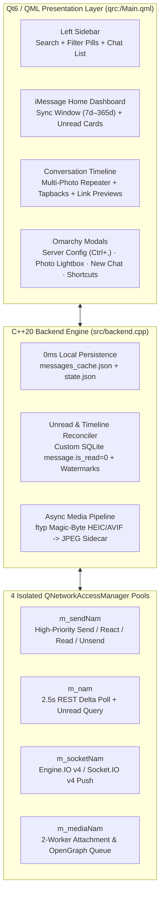

# `imsg` Architecture & Protocol Deep Dive

`imsg` is engineered in **C++20** and **Qt6 / Qt Quick Controls 2 (QML)** to provide sub-10ms responsiveness, zero database lock crashes, and pixel-accurate parity with macOS `Messages.app` when paired with a BlueBubbles relay.



---

## 1. Four-Pool `QNetworkAccessManager` Isolation

Qt's `QNetworkAccessManager` throttles concurrent HTTP requests per host to 6 connections. In naive clients, queuing 10+ full-resolution photo downloads starves outgoing `POST /api/v1/message/text` or `POST /api/v1/message/react` calls.

`imsg` isolates network traffic across **4 dedicated `QNetworkAccessManager` instances**:
1. **`m_sendNam` (`HighPriority`):** Dedicated exclusively to user-initiated writes (`sendMessage`, `sendReaction`, `markChatRead`, `markChatUnread`, `deleteMessage`, `unsendMessage`, `deleteChat`). Outgoing messages and tapbacks update the UI optimistically in **0ms** and never queue behind media transfers.
2. **`m_socketNam`:** Dedicated to the long-lived Engine.IO v4 (`EIO=4&transport=polling`) push stream (`85s` transfer timeout) so real-time `new-message` and `updated-message` events arrive within `<10ms`.
3. **`m_nam`:** Handles `fetchServerInfo()`, `fetchChatsMetadata()`, `pollDelta()` (2.5s interval), and `fetchUnreadStateFromServer()`.
4. **`m_mediaNam`:** Drives a bounded 2-worker attachment download queue (`pumpAttachmentDownloadQueue()`) and OpenGraph metadata fetcher (`fetchLinkPreview()`).

---

## 2. Authoritative Unread Reconciliation (`message.is_read = 0`)

On macOS Sequoia (`15.x`), `Messages.app` updates `message.is_read = 1` and `message.date_read` in `chat.db` when a thread is read on an iPhone, iPad, or Mac, **without** bumping `chat.last_read_message_timestamp` if the message was read on another iCloud device.

To guarantee 100% accurate unread badges across all devices:
- Every 5 seconds (and immediately on Socket.IO `chat-read-status-changed` / `updated-message` events), `Backend::fetchUnreadStateFromServer()` executes a custom SQLite `where` clause via `POST /api/v1/message/query`:
  ```json
  {
    "limit": 500,
    "offset": 0,
    "with": ["chat", "handle"],
    "sort": "DESC",
    "where": [
      {
        "statement": "message.is_from_me = 0 AND message.item_type = 0 AND message.is_read = 0 AND (message.associated_message_type IS NULL OR message.associated_message_type = 0)",
        "args": null
      }
    ]
  }
  ```
- `Backend::reconcileServerUnreadMessages()` compares the authoritative set of unread message GUIDs against local `m_chatMessagesCache` and clears stale unread badges within seconds of reading a conversation on an iPhone.

---

## 3. Orphan Short-Code SMS & Delayed Forwarding Recovery

1. **120-Second Delta Lookback Window:** When an iPhone forwards a carrier SMS/RCS message to the macOS relay via Text Message Forwarding, `message.dateCreated` reflects the original iPhone receipt timestamp (often 5–45 seconds earlier than when the row lands in macOS `chat.db`). `Backend::pollDelta()` queries `after = max(0, m_lastMessageTimestamp - 120000)` and deduplicates via `m_seenMessageGuids` so delayed SMS messages are never skipped.
2. **Orphan SMS Chat Synthesis:** Occasionally, macOS `IMDPersistenceAgent` inserts a short-code verification SMS (e.g., `22000`) into `message` with a valid `handle.address` before committing the `chat_message_join` row (`chats: []`). Both `processIncomingMessages()` and `reconcileServerUnreadMessages()` detect empty `chats` arrays and synthesize a deterministic fallback chat (`SMS;-;<address>`) so 2FA codes appear immediately.

---

## 4. Disguised HEIC/AVIF Magic-Byte Inspection & Sidecar Conversion

BlueBubbles's Socket.IO `new-message` payload sometimes names incoming iPhone photos `*.heic.jpeg` even though the raw payload starts with ISO Base Media File Format `ftypheic` / `ftypmif1` magic bytes (`bytes[4..7] == "ftyp"`).

If Qt's standard JPEG reader attempts to decode raw `ftypheic` bytes disguised with a `.jpeg` extension, decoding fails silently. `imsg` prevents this at two layers:
1. **Disk Cache Indexing (`indexCachedAttachmentsOnDisk()`):** Inspects the first 12 bytes of every cached attachment; any file with `ftyp` at offset 4 is rejected unless a verified JPEG (`\xFF\xD8\xFF`) `.heic.jpg` sidecar exists.
2. **Async Conversion Worker (`resolveOrConvertAsync`):** Inspects downloaded bytes in a background thread (`QtConcurrent::run`) and converts any `ftyp` HEIC/HEIF/AVIF buffer via `heif-convert` or ImageMagick (`magick`) into a standard `.heic.jpg` file before emitting `attachmentReady(guid, localUrl)`.

---

## 5. Scroll-Position Preservation During Live Tapbacks

When a user sends or receives a tapback reaction while scrolled midway through a long conversation, rebuilding `m_messages` (`QVariantList`) would normally reset QML `ListView.contentY` to `0` (top of chat).

`src/Main.qml` connects to `Backend::aboutToChangeMessages()` before `m_messages` is mutated, snapshots `contentY`, `contentHeight`, and `stickToBottom`, and restores the exact pixel viewport offset across layout passes (`restorePassesRemaining`) so adding a tapback reaction never jumps the scroll position.
