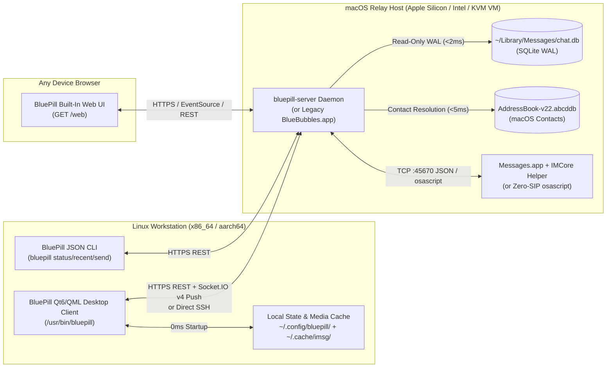

# BluePill Architecture & Internals

## 1. Linux Desktop Client (`src/backend.{h,cpp}`, `src/Main.qml`)
- **Zero-Latency Startup (`messages_cache.json`):** Loads up to 500 cached messages per conversation from disk before the first network packet is sent.
- **Isolated Network Pools (`m_nam`, `m_sendNam`, `m_mediaNam`, `m_socketNam`):** User mutations (`sendMessage`, `sendReaction`, `markChatRead`) execute on a dedicated high-priority `QNetworkAccessManager` (`m_sendNam`) so background image downloads on `m_mediaNam` (`?force=false`, max 2 concurrent) can never stall outbound messages.
- **Magic-Byte (`ftyp`) HEIC/AVIF Transcoding:** Inspects the first 16 bytes of every downloaded attachment for ISO BMFF `ftyp` headers and converts disguised `.heic.jpeg` / `.avif` files to standard JPEG (`\xFF\xD8\xFF`) asynchronously.

## 2. Headless macOS Relay (`server/bluepill_server.py`) & Built-In Web UI
- **Direct SQLite WAL Reader:** Queries `~/Library/Messages/chat.db` in read-only WAL mode (`?mode=ro`), decoding `attributedBody` typedstreams and exposing `is_read`, `date_read`, `date_edited`, `date_retracted`, `error`, and `expressive_send_style_id` directly in JSON responses.
- **Dual-Mode Action Dispatcher:** Connects to `IMCore` (`localhost:45670`) when the Private API helper is loaded inside `Messages.app`, and falls back automatically to `osascript` on SIP-enabled Macs.
- **Built-In Web UI (`/web`):** Self-contained dark-mode web application served directly by `bluepill-server` with conversation search, pinned chats, tapbacks, 1-click OTP copy, and real-time message streaming.
