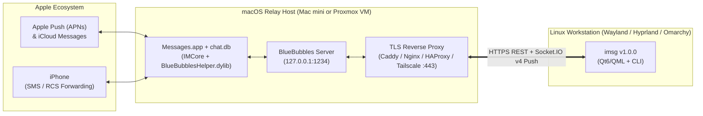

# BlueBubbles macOS Relay Setup Guide for `imsg`

`imsg` communicates with Apple's iMessage, RCS, and SMS ecosystem through a macOS host running **[BlueBubbles Server](https://bluebubbles.app/)**. Because Apple's `imagent` and `IMCore` frameworks run natively inside macOS `Messages.app`, using a dedicated macOS relay avoids Apple ID bans and supports full Private API features (tapbacks, replies, unsends, edits, and bidirectional read-state sync).



---

## Step 1: Prepare the macOS Host (Physical Mac or Proxmox VM)

You can run BlueBubbles on:
- **Physical Apple Hardware:** Any Mac mini (Intel or Apple Silicon M1/M2/M4) or MacBook configured to never sleep.
- **Proxmox VE Virtual Machine:** macOS Sonoma (14) or macOS Sequoia (15) running under QEMU/KVM with OpenCore (`host` or `Haswell-noTSX` CPU type, VirtIO/VMXNET3 NIC, 4+ vCPUs, 8 GB RAM, and a unique SMBIOS Serial/MLB/ROM generated via `macserial`).

### Disable Sleep & Auto-Logout on macOS

Run the following in macOS Terminal so the relay stays online 24/7:

```bash
sudo systemsetup -setcomputersleep Never
sudo systemsetup -setdisplaysleep 15
sudo systemsetup -setharddisksleep Never
sudo pmset -a sleep 0 displaysleep 15 disksleep 0 autorestart 1 womp 1
```

Enable **Automatic Login** in **System Settings → Users & Groups → Automatically log in as** so `Messages.app` and `BlueBubbles.app` launch automatically after a reboot.

---

## Step 2: Sign In to `Messages.app` & Enable iPhone Forwarding

1. Open **`Messages.app`** on the macOS relay and sign in with your Apple Account.
2. Open **Messages → Settings → iMessage**:
   - Check **Enable Messages in iCloud** and click **Sync Now**.
   - Under **You can be reached for messages at**, select your phone number and Apple ID email(s).
   - Set **Start new conversations from** to your primary phone number.
3. On your **iPhone**:
   - Go to **Settings → Apps → Messages → Text Message Forwarding**.
   - Toggle **ON** your macOS relay host so carrier SMS, MMS, and RCS messages are bridged to macOS `Messages.app` in real time.

---

## Step 3: Retain 2FA / Verification Code SMS Messages on macOS Sequoia

By default, macOS Sonoma/Sequoia and iOS 17+ can automatically purge or quarantine incoming 2FA verification codes if **Clean Up Automatically** (`DeleteVerificationCodes`) is enabled, or delay writing the `chat_message_join` row for short-code SMS senders (such as `22000` or `63879`).

Run this command on your macOS relay to ensure all 2FA verification codes are retained in `chat.db` and immediately visible to `imsg`:

```bash
defaults write com.apple.MobileSMS DeleteVerificationCodes -bool false
killall Messages IMDPersistenceAgent imagent 2>/dev/null || true
open -a Messages
```

> [!TIP]
> Even if macOS `IMDPersistenceAgent` writes a short-code SMS into the `message` table before creating its `chat_message_join` entry, `imsg v1.0.0` automatically synthesizes a fallback `SMS;-;<sender>` conversation from `handle.address` and renders a one-click **`Copy Code`** pill.

---

## Step 4: Configure SIP & Enable BlueBubbles Private API

The BlueBubbles **Private API** injects `BlueBubblesHelper.dylib` into `Messages.app` (via MacForge / ScriptingAdditions) and enables:
- Sending & removing **Tapback reactions** (`❤️`, `👍`, `👎`, `😂`, `‼️`, `❓`)
- **Inline threaded replies**
- **Unsending** (`↩`) and **editing** sent iMessages
- **Marking chats as read** across all Apple devices (`POST /api/v1/chat/:guid/read`)

### Partially Disable SIP (Recovery Mode)

1. Reboot the Mac into **Recovery Mode** (hold Power on Apple Silicon, or `Cmd+R` / OpenCore Recovery on Intel/VM).
2. Open **Utilities → Terminal** and run:
   ```bash
   csrutil enable --without debug --without fs
   ```
   *(Alternatively, `csrutil disable` fully disables SIP).*
3. Reboot into macOS and enable non-library-validation boot-args if required by macOS Sequoia:
   ```bash
   sudo nvram boot-args="amfi_get_out_of_my_way=0x1 -arm64e_preview_abi"
   ```
4. Reboot once more for the NVRAM `boot-args` to take effect.

---

## Step 5: Install & Configure `BlueBubbles.app`

1. Download the latest macOS release from [GitHub — BlueBubblesReleases](https://github.com/BlueBubblesApp/bluebubbles-server/releases).
2. Move **`BlueBubbles.app`** to `/Applications` and launch it.
3. Grant **Full Disk Access** and **Accessibility** permissions in **System Settings → Privacy & Security**:
   - Add `/Applications/BlueBubbles.app`
   - Add `/System/Applications/Messages.app`
   - Add `/Applications/Utilities/Terminal.app`
4. Inside **BlueBubbles Server Settings**:
   - **Server Port:** `1234` (default local HTTP port)
   - **Server Password:** Generate a strong 32+ character API key/password.
   - **Proxy Service:** Select **Dynamic DNS / Custom URL** (or Cloudflare / Tailscale) and set your HTTPS hostname (e.g., `https://bluebubbles.example.com`).
   - **Private API:** Toggle **Enable Private API** and install the helper bundle when prompted. Verify Status shows **Connected**.
   - **Startup:** Enable **Start with Mac** and **Keep Mac Awake**.

---

## Step 6: Configure a TLS Reverse Proxy in Front of Port `1234`

`imsg` connects over HTTPS (`REST` + `Socket.IO v4` long-polling). Place a reverse proxy with a valid TLS certificate (Let's Encrypt / ACME or internal CA) in front of the macOS relay's port `1234`.

### Option A: Caddy (`Caddyfile`)

```caddyfile
bluebubbles.example.com {
    reverse_proxy 192.0.2.55:1234 {
        flush_interval -1
        transport http {
            read_timeout 120s
            write_timeout 120s
        }
    }
}
```

### Option B: Nginx (`nginx.conf`)

```nginx
server {
    listen 443 ssl http2;
    server_name bluebubbles.example.com;

    ssl_certificate     /etc/letsencrypt/live/bluebubbles.example.com/fullchain.pem;
    ssl_certificate_key /etc/letsencrypt/live/bluebubbles.example.com/privkey.pem;

    location / {
        proxy_pass http://192.0.2.55:1234;
        proxy_http_version 1.1;
        proxy_set_header Upgrade $http_upgrade;
        proxy_set_header Connection "upgrade";
        proxy_set_header Host $host;
        proxy_set_header X-Real-IP $remote_addr;
        proxy_set_header X-Forwarded-For $proxy_add_x_forwarded_for;
        proxy_set_header X-Forwarded-Proto $scheme;
        proxy_read_timeout 120s;
        proxy_buffering off;
    }
}
```

### Option C: HAProxy (`haproxy.cfg`)

```haproxy
backend be_bluebubbles
    mode http
    timeout server 120s
    timeout tunnel 3600s
    option httpchk GET /api/v1/ping
    server macos-relay 192.0.2.55:1234 check inter 5s fall 3 rise 2
```

### Option D: Tailscale HTTPS (`tailscale serve`)

Directly on the macOS relay with Tailscale MagicDNS + HTTPS certificates enabled:

```bash
tailscale serve --bg 1234
```

---

## Step 7: Connect `imsg` on Linux

1. Launch `imsg` on your Linux workstation.
2. In the **BlueBubbles Server Configuration** modal (`Ctrl+,` or click **`⚙ Server`**):
   - **Primary Server URL:** `https://bluebubbles.example.com`
   - **Failover Server URL (Optional):** `https://backup-relay.example.com`
   - **API Password / Key:** Your BlueBubbles Server password
3. Click **Save & Connect**.
4. Verify via CLI:
   ```bash
   imsg status --json
   ```
