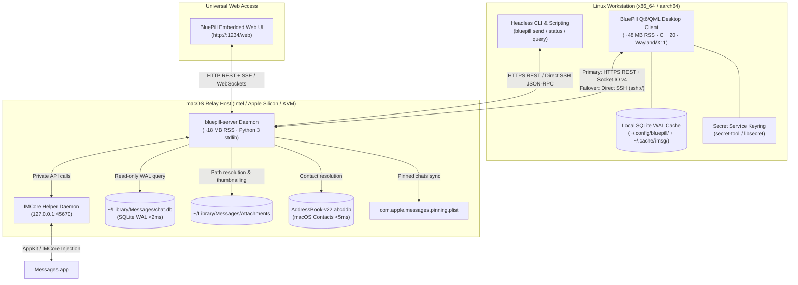

> [!TIP]
> **Interactive Documentation Portal:** View the formatted dark-mode documentation with one-click copy buttons and live sidebar navigation at:  
> [**https://nertwork.github.io/bluepill/INSTALLATION_AND_OPERATIONS_GUIDE.html**](https://nertwork.github.io/bluepill/INSTALLATION_AND_OPERATIONS_GUIDE.html)

# 💊 BluePill Complete Installation & Operations Guide

A comprehensive, production-grade installation, administration, and operations manual for **BluePill** (`bluepill` / `bluepill-server`), the open-source, zero-Electron iMessage, RCS, and SMS ecosystem for Linux workstations and macOS relays.

---

## Table of Contents
1. [Architecture & Ecosystem Overview](#1-architecture--ecosystem-overview)
2. [Linux Desktop Installation & Configuration](#2-linux-desktop-installation--configuration)
   - [Arch Linux & Omarchy (x86_64 & Apple Silicon ARM64)](#arch-linux--omarchy-x86_64--apple-silicon-arm64)
   - [Waybar Module Integration](#waybar-module-integration)
   - [Hyprland Window Rules & Keybindings](#hyprland-window-rules--keybindings)
   - [Secret Service Keyring Integration](#secret-service-keyring-integration)
   - [PipeWire & Voice Memo Support](#pipewire--voice-memo-support)
   - [Debian & Ubuntu](#debian--ubuntu)
   - [Fedora & RHEL](#fedora--rhel)
   - [NixOS & Generic Linux](#nixos--generic-linux)
3. [macOS Relay Server (`bluepill-server`) Setup](#3-macos-relay-server-bluepill-server-setup)
   - [Prerequisites & Supported Versions](#prerequisites--supported-versions)
   - [Homebrew Installation](#homebrew-installation)
   - [Full Disk Access & Permissions](#full-disk-access--permissions)
   - [Configuration & Self-Test](#configuration--self-test)
   - [macOS LaunchAgent Daemon](#macos-launchagent-daemon)
   - [IMCore Private API Helper (:45670)](#imcore-private-api-helper-45670)
   - [Direct SSH vs HTTP/REST Transports](#direct-ssh-vs-httprest-transports)
   - [Reverse Proxy & TLS Termination](#reverse-proxy--tls-termination)
4. [Built-In Web UI Operations (`/web`)](#4-built-in-web-ui-operations-web)
5. [Complete REST & RPC API Reference](#5-complete-rest--rpc-api-reference)
6. [Operational Runbooks & Troubleshooting](#6-operational-runbooks--troubleshooting)

---

## 1. Architecture & Ecosystem Overview

BluePill decouples the Apple Messages ecosystem into high-performance, native components tailored for modern Linux desktops and headless macOS hosts without Electron, Flutter, or Node.js bloat:



### Core Components

1. **Native Linux Desktop Client (`bluepill`):**
   - **Engine:** C++20 compiled binary with Qt 6.4+ / QML.
   - **Footprint:** ~48 MB RSS memory usage under active load.
   - **Display:** Wayland native (Hyprland, Sway, KDE Plasma, GNOME) and X11 fallback.
   - **Latency:** Instant 0ms startup using local SQLite WAL thread cache and asynchronous background delta synchronization.
   - **Push Transport:** Real-time push notifications over Engine.IO v4 / Socket.IO v4 WebSocket connections.
   - **Features:** Pinned conversations avatar bar, 1-click 2FA OTP copy pill, inline photo viewer lightbox, multi-photo attachments gallery, `Ctrl+V` clipboard image pasting, theme hot-reloading (Omarchy / Catppuccin / Tokyo Night / Solarized).

2. **Headless macOS Relay Server (`bluepill-server`):**
   - **Engine:** Zero-Electron, single-file Python 3 standard library daemon (`sqlite3`, `plistlib`, `http.server`, `threading`).
   - **Footprint:** ~18 MB RSS memory usage.
   - **Database Access:** Direct read-only SQLite WAL access to `~/Library/Messages/chat.db` with query execution times consistently `<2ms`.
   - **Contact Resolution:** Direct queries against `AddressBook-v22.abcddb` with phone number and email normalization in `<5ms`.
   - **Backward Compatibility:** 100% drop-in compatible with the legacy BlueBubbles Server (`1.9.x`) REST API and Socket.IO protocol.

3. **IMCore Private API Helper (`:45670`):**
   - Lightweight companion agent listening on `127.0.0.1:45670`.
   - Interacts with macOS internal `IMCore` frameworks to unlock advanced iMessage capabilities:
     - Real-time Tapback reactions (Love, Like, Dislike, Laugh, Emphasize, Question).
     - Native inline thread replies and parent message association.
     - Message editing and unsend capabilities (macOS Ventura+).
     - Expressive send effects (Confetti, Slam, Lasers, Invisible Ink, Echo, etc.).
     - Live typing indicators and background read receipts.
     - Group chat participant additions and removals.
   - If the helper is not active, `bluepill-server` automatically falls back to Zero-SIP AppleScript (`osascript`) sending mode.

4. **Embedded Web UI (`/web`):**
   - Built directly into `bluepill-server` with zero external dependencies.
   - Provides full browser access at `http://<relay-host>:1234/web` on any desktop, laptop, tablet, or phone.
   - Features inline 28-bar voice memo waveform players, browser audio recording (`🎙`), Expressive Send pickers, Send Later scheduled messaging, attachment drag-and-drop, global search, Find My tracking, and live server logs.

5. **Direct SSH Transport (`ssh://`):**
   - Enables secure, firewall-bypassing communication without exposing HTTP/HTTPS ports to the public Internet.
   - Spawns `bluepill-server stdio` on the remote Mac over standard OpenSSH tunnels and exchanges line-delimited JSON-RPC messages.

---

## 2. Linux Desktop Installation & Configuration

### Arch Linux & Omarchy (x86_64 & Apple Silicon ARM64)

The official package is distributed via the Arch User Repository (AUR) as `bluepill`.

#### 1. Installation via AUR Helper
```bash
# Using yay
yay -S bluepill

# Using paru
paru -S bluepill
```

#### 2. Manual PKGBUILD Compilation
```bash
git clone https://aur.archlinux.org/bluepill.git /tmp/bluepill-aur
cd /tmp/bluepill-aur
makepkg -si
```

#### 3. Verified System Packages Installed
- Binary: `/usr/bin/bluepill`
- Legacy compatibility symlink: `/usr/bin/imsg -> bluepill`
- Desktop Entry: `/usr/share/applications/bluepill.desktop`
- Scalable Icon: `/usr/share/icons/hicolor/scalable/apps/bluepill.svg`
- Sound Asset: `/usr/share/bluepill/imessage-notify.wav`
- Systemd User Unit: `/usr/lib/systemd/user/bluepill.service`

#### 4. Background Service Activation
To launch BluePill automatically on graphical login:
```bash
systemctl --user daemon-reload
systemctl --user enable --now bluepill.service
```

---

### Waybar Module Integration

For tiling Wayland setups (Hyprland / Sway / Omarchy), BluePill includes an unread notification count script for Waybar.

#### 1. Helper Script (`~/.local/bin/bluepill-waybar`)
```bash
cat << 'EOF_WAYBAR' > ~/.local/bin/bluepill-waybar
#!/usr/bin/env bash
set -euo pipefail

STATE_FILE="${HOME}/.config/imsg/state.json"
[[ -f "${HOME}/.config/bluepill/state.json" ]] && STATE_FILE="${HOME}/.config/bluepill/state.json"

if [[ ! -f "$STATE_FILE" ]]; then
    echo '{"text": "", "alt": "disconnected", "tooltip": "BluePill: Disconnected", "class": "disconnected"}'
    exit 0
fi

UNREAD=$(jq -r '.unreadCount // 0' "$STATE_FILE" 2>/dev/null || echo 0)
CONNECTED=$(jq -r '.connected // false' "$STATE_FILE" 2>/dev/null || echo false)

if [[ "$CONNECTED" != "true" ]]; then
    echo '{"text": "󰍡 !", "alt": "offline", "tooltip": "BluePill: Relay Offline", "class": "offline"}'
elif [[ "$UNREAD" -gt 0 ]]; then
    echo "{\"text\": \"󰍡 ${UNREAD}\", \"alt\": \"unread\", \"tooltip\": \"${UNREAD} unread message(s)\", \"class\": \"unread\", \"count\": ${UNREAD}}"
else
    echo '{"text": "󰍡", "alt": "read", "tooltip": "BluePill: Connected", "class": "read"}'
fi
EOF_WAYBAR
chmod +x ~/.local/bin/bluepill-waybar
```

#### 2. Waybar Configuration (`~/.config/waybar/config.jsonc`)
Add `"custom/bluepill"` to your modules list:
```json
"custom/bluepill": {
    "format": "{}",
    "return-type": "json",
    "exec": "~/.local/bin/bluepill-waybar",
    "interval": 2,
    "on-click": "bluepill",
    "signal": 8
}
```

#### 3. Waybar Styling (`~/.config/waybar/style.css`)
```css
#custom-bluepill {
    padding: 0 10px;
    color: #e6edf3;
}

#custom-bluepill.unread {
    color: #0a84ff;
    font-weight: bold;
    animation: blink 1s ease infinite alternate;
}

#custom-bluepill.offline {
    color: #f85149;
}
```

---

### Hyprland Window Rules & Keybindings

Add the following rules to `~/.config/hypr/hyprland.conf` for a dedicated scratchpad window experience:

```ini
# Floating window behavior for BluePill
windowrulev2 = float, class:^(bluepill|imsg)$
windowrulev2 = size 1080 840, class:^(bluepill|imsg)$
windowrulev2 = center, class:^(bluepill|imsg)$
windowrulev2 = workspace special:imsg, class:^(bluepill|imsg)$

# Toggle scratchpad with Super + M
bind = $mainMod, M, togglespecialworkspace, imsg

# Launch or focus BluePill if not running
bind = $mainMod SHIFT, M, exec, bluepill
```

---

### Secret Service Keyring Integration

BluePill uses the Freedesktop Secret Service standard (`libsecret` / `secret-tool`) to securely store your relay password outside plaintext configuration files.

#### 1. Store Credentials Securely
```bash
# Store the relay password in the system keyring
secret-tool store --label="BluePill Relay Password" service bluepill username relay
# (Enter your password at the prompt)
```

#### 2. Verify Keyring Storage
```bash
secret-tool lookup service bluepill username relay
```

If the keyring item is present, BluePill will automatically query `secret-tool` before reading credentials from `~/.config/bluepill/config.json`.

---

### PipeWire & Voice Memo Support

BluePill natively renders 28-bar audio waveforms and plays incoming voice memos using PipeWire / PulseAudio.

#### Required Audio Packages:
```bash
# Arch Linux
sudo pacman -S pipewire pipewire-pulse pipewire-audio ffmpeg libnotify

# Debian / Ubuntu
sudo apt-get install pipewire pipewire-pulse ffmpeg libnotify-bin
```

#### Playback Verification:
```bash
paplay /usr/share/bluepill/imessage-notify.wav
```

---

### Debian & Ubuntu

#### 1. Install Build Dependencies
```bash
sudo apt-get update
sudo apt-get install -y \
    build-essential \
    cmake \
    ninja-build \
    qt6-base-dev \
    qt6-declarative-dev \
    qt6-quickcontrols2-5-dev \
    qt6-svg-dev \
    qt6-wayland-dev \
    libsecret-1-dev \
    libnotify-dev \
    libheif-dev \
    ffmpeg
```

#### 2. Build and Install via CMake
```bash
git clone https://github.com/nertwork/bluepill.git /tmp/bluepill
cd /tmp/bluepill
cmake -B build -DCMAKE_BUILD_TYPE=Release -GNinja
cmake --build build -j$(nproc)
sudo cmake --install build
sudo ln -sf /usr/local/bin/bluepill /usr/local/bin/imsg
```

---

### Fedora & RHEL

#### 1. Install Build Dependencies
```bash
sudo dnf install -y \
    gcc-c++ \
    cmake \
    ninja-build \
    qt6-qtbase-devel \
    qt6-qtdeclarative-devel \
    qt6-qtsvg-devel \
    qt6-qtwayland-devel \
    libsecret-devel \
    libnotify-devel \
    libheif-devel \
    ffmpeg
```

#### 2. Build and Install
```bash
git clone https://github.com/nertwork/bluepill.git /tmp/bluepill
cd /tmp/bluepill
cmake -B build -DCMAKE_BUILD_TYPE=Release -GNinja
cmake --build build -j$(nproc)
sudo cmake --install build
sudo ln -sf /usr/local/bin/bluepill /usr/local/bin/imsg
```

---

### NixOS & Generic Linux

Create a `shell.nix` in the repository root:
```nix
{ pkgs ? import <nixpkgs> {} }:

pkgs.mkShell {
  buildInputs = with pkgs; [
    cmake
    ninja
    qt6.qtbase
    qt6.qtdeclarative
    qt6.qtsvg
    qt6.qtwayland
    libsecret
    libnotify
    ffmpeg
  ];
}
```

Run inside the nix shell:
```bash
nix-shell --run "cmake -B build -DCMAKE_BUILD_TYPE=Release && cmake --build build -j && sudo cmake --install build"
```

---

## 3. macOS Relay Server (`bluepill-server`) Setup

`bluepill-server` is a zero-Electron, high-performance relay server designed to run directly on macOS with minimal resource consumption (~18 MB RSS).

### Prerequisites & Supported Versions
- **macOS Versions:** Big Sur (11.x), Monterey (12.x), Ventura (13.x), Sonoma (14.x), Sequoia (15.x), Tahoe (26.x).
- **Architecture:** Apple Silicon (`arm64`) and Intel (`x86_64`) hardware or KVM/Proxmox macOS guests.
- **Apple Account:** The Mac must be actively logged into your Apple ID in `Messages.app`.
- **SMS / RCS Forwarding:** On your iPhone, enable forwarding under **Settings -> Apps -> Messages -> Text Message Forwarding -> [Your Mac Name]**.

---

### Homebrew Installation

```bash
# Add the official tap
brew tap nertwork/tap

# Install bluepill-server
brew install nertwork/tap/bluepill

# Verify binary installation
bluepill-server --version
# Output: bluepill-server 1.1.0
```

---

### Full Disk Access & Permissions

macOS Privacy protections (TCC) protect `~/Library/Messages/chat.db` and Contacts databases. You must grant **Full Disk Access** to allow `bluepill-server` to read messages and resolve contacts.

#### Granting Full Disk Access:
1. Open **System Settings** (or **System Preferences** on older versions).
2. Navigate to **Privacy & Security** -> **Full Disk Access**.
3. Unlock the pane and click **+**.
4. Add the following binaries:
   - Your active terminal emulator (e.g., `Terminal.app`, `iTerm2`, or `Alacritty`).
   - If running via SSH: `/usr/libexec/sshd-keygen-wrapper`.
   - The Python 3 interpreter used by Homebrew (e.g., `/opt/homebrew/bin/python3` on Apple Silicon or `/usr/local/bin/python3` on Intel).
   - The `bluepill-server` executable (run `which bluepill-server`).

#### Granting Automation Permissions:
Under **Privacy & Security** -> **Automation**, ensure your terminal / service has permission to control **Messages.app**.

#### Verification Command:
Run this non-interactive check in your terminal:
```bash
sqlite3 ~/Library/Messages/chat.db "SELECT count(*) FROM chat;" </dev/null
```
If this prints an integer (e.g., `42`), Full Disk Access is working properly. If you receive `Error: unable to open database file: unable to open database file` or `Operation not permitted`, re-verify your Full Disk Access entries.

---

### Configuration & Self-Test

#### 1. Generate Configuration File
Create `~/.config/bluepill/server.json` with strict `0600` permissions:

```bash
mkdir -p ~/.config/bluepill
cat << 'EOF_CONFIG' > ~/.config/bluepill/server.json
{
  "host": "0.0.0.0",
  "port": 1234,
  "password": "CHANGE_ME_TO_A_SECURE_TOKEN",
  "helperPort": 45670,
  "enableBackgroundDaemons": true
}
EOF_CONFIG
chmod 600 ~/.config/bluepill/server.json
```

#### 2. Run Built-In Self-Test
Verify timestamp conversion, typedstream parsing, and database bindings:
```bash
bluepill-server --selftest </dev/null
```
Expected output:
```json
{"status": "ok", "selftest": "passed", "version": "1.1.0", "os_version": "Darwin-24.3.0", "private_api": true}
```

#### 3. Inspect Live Diagnostics & Status
```bash
# Print current server configuration and database health
bluepill-server status

# Print recent log lines
bluepill-server logs -n 50
```

---

### macOS LaunchAgent Daemon

To ensure `bluepill-server` starts automatically on user login and survives system reboots:

#### 1. Create LaunchAgent Plist
```bash
mkdir -p ~/Library/LaunchAgents
cat << 'EOF_PLIST' > ~/Library/LaunchAgents/com.nertwork.bluepill-server.plist
<?xml version="1.0" encoding="UTF-8"?>
<!DOCTYPE plist PUBLIC "-//Apple//DTD PLIST 1.0//EN" "http://www.apple.com/DTDs/PropertyList-1.0.dtd">
<plist version="1.0">
<dict>
    <key>Label</key>
    <string>com.nertwork.bluepill-server</string>
    <key>ProgramArguments</key>
    <array>
        <string>/opt/homebrew/bin/bluepill-server</string>
        <string>serve</string>
        <string>--port</string>
        <string>1234</string>
        <string>--password</string>
        <string>CHANGE_ME_TO_A_SECURE_TOKEN</string>
    </array>
    <key>RunAtLoad</key>
    <true/>
    <key>KeepAlive</key>
    <true/>
    <key>StandardOutPath</key>
    <string>/tmp/bluepill-server.log</string>
    <key>StandardErrorPath</key>
    <string>/tmp/bluepill-server.err</string>
    <key>ProcessType</key>
    <string>Interactive</string>
</dict>
</plist>
EOF_PLIST
```
*(Note: On Intel Macs, replace `/opt/homebrew/bin/bluepill-server` with `/usr/local/bin/bluepill-server`.)*

#### 2. Load and Bootstrap the Daemon
```bash
launchctl bootstrap gui/$(id -u) ~/Library/LaunchAgents/com.nertwork.bluepill-server.plist
```

#### 3. Homebrew Services Alternative
If installed via Homebrew, you can also manage the daemon using:
```bash
brew services start bluepill
```

---

### IMCore Private API Helper (:45670)

The **IMCore Private API Helper** (`BlueBubblesHelper`) connects directly to Apple's private `IMCore` runtime to enable features impossible via standard AppleScript:

| Feature | Private API (:45670) | Zero-SIP Fallback (`osascript`) |
| :--- | :---: | :---: |
| **Send Text & Attachments** | Yes (Instant) | Yes (<1s) |
| **Tapback Reactions** (Heart, Like, etc.) | Yes (Instant) | No |
| **Inline Thread Replies** | Yes (Linked) | No (Sent as standalone) |
| **Edit Message** (Ventura+) | Yes | No |
| **Unsend Message** (Ventura+) | Yes | No |
| **Expressive Effects** (Confetti, Lasers) | Yes | No |
| **Typing Indicators** | Yes | No |
| **Group Participant Add/Remove** | Yes | No |

When `bluepill-server` starts, it automatically attempts to connect to `127.0.0.1:45670`. If active, `private_api: true` is reported in `/api/v1/server/info`. If not running, `bluepill-server` gracefully falls back to AppleScript for sending messages.

---

### Direct SSH vs HTTP/REST Transports

BluePill supports two primary connection methods between Linux workstations and macOS relays:

#### Method 1: HTTP/REST + Socket.IO v4 (Recommended for LAN / VPN)
- Connects over LAN, WireGuard, or Tailscale.
- Full two-way push event delivery via WebSockets.
- URL Format: `http://192.168.1.50:1234` or `https://bluepill.internal.net`.

#### Method 2: Direct SSH Transport (`ssh://`)
- Runs entirely over an encrypted OpenSSH session.
- Requires no open server ports, no port forwarding, and zero public exposure.
- Executes `bluepill-server stdio` on the remote host and exchanges newline-delimited JSON-RPC messages.
- URL Format in client: `ssh://user@mac-host` or `ssh://user@mac-host:22`.

---

### Reverse Proxy & TLS Termination

To expose your relay over HTTPS with public or private TLS certificates:

#### Caddy Configuration (`/etc/caddy/Caddyfile`)
```caddy
bluepill.example.com {
    reverse_proxy 127.0.0.1:1234 {
        header_up Host {host}
        header_up X-Real-IP {remote_host}
    }
}
```

#### Nginx Configuration
```nginx
server {
    listen 443 ssl http2;
    server_name bluepill.example.com;

    ssl_certificate /etc/letsencrypt/live/bluepill.example.com/fullchain.pem;
    ssl_certificate_key /etc/letsencrypt/live/bluepill.example.com/privkey.pem;

    location / {
        proxy_pass http://127.0.0.1:1234;
        proxy_http_version 1.1;
        proxy_set_header Upgrade $http_upgrade;
        proxy_set_header Connection "upgrade";
        proxy_set_header Host $host;
        proxy_set_header X-Real-IP $remote_addr;
        proxy_read_timeout 86400s;
        proxy_send_timeout 86400s;
    }
}
```

#### Tailscale Serve
If using Tailscale on your Mac, terminate TLS effortlessly:
```bash
tailscale serve --bg 1234
```

---

## 4. Built-In Web UI Operations (`/web`)

Every instance of `bluepill-server` includes an embedded, dark-slate Web client accessible at:
```text
http://<relay-host>:1234/web
```

### Key Capabilities in the Web UI:

1. **Authentication:**
   - Enter your relay password in the top-right authorization input or pass it in the query string: `http://<host>:1234/web?password=YOUR_PASSWORD`.
   - Credentials are saved in browser `localStorage`.

2. **Pinned Conversations Avatar Bar:**
   - Displays circular avatar shortcuts synchronized with macOS `com.apple.messages.pinning.plist`.
   - Click any avatar to jump directly to the thread.

3. **Inline 28-Bar Voice Memo Player & `🎙` Recorder:**
   - Renders animated 28-bar audio waveforms for incoming audio clips.
   - Click the `🎙` microphone icon to record voice memos in your browser and dispatch them as `.m4a` audio attachments.

4. **`✨` Expressive Send Effects:**
   - Select and apply screen effects: Confetti, Slam, Loud, Gentle, Echo, Spotlight, Lasers, Fireworks, Shooting Star, Celebration, or Invisible Ink.

5. **`🕒 Send Later` Scheduled Messages:**
   - Schedule messages to be sent automatically at a future date and time.
   - View, edit, or cancel pending scheduled messages from the scheduled queue.

6. **Drag-and-Drop & `Ctrl+V` File Uploads:**
   - Drag image or video files directly into the conversation window.
   - Paste screenshots directly from your system clipboard (`Ctrl+V` / `Cmd+V`).

7. **Message Actions:**
   - Hover over any message bubble to trigger Tapback reactions (Heart, Thumbs Up, Laugh, etc.), Inline Thread Replies, or Unsend / Edit.

8. **1-Click 2FA OTP Copy Pill:**
   - Verification codes in incoming 2FA SMS and iMessages are automatically extracted and presented with an interactive `🔑 Copy <code>` button.

9. **Global Full-Text Search:**
   - Search across historical messages, handles, and chat titles with instant matching.

10. **Find My Devices & Friends:**
    - Live tab showing battery status, geolocation coordinates, and physical addresses of tracked Apple devices and shared friends.

11. **Live Server Logs Viewer:**
    - Streams live server logs and connection telemetry directly inside the browser.

---

## 5. Complete REST & RPC API Reference

All REST endpoints support authentication via the `X-BlueBubbles-Auth` header, `Authorization: Bearer <token>`, or `?password=<token>` query parameter. All JSON requests and responses use UTF-8 encoding.

### API Endpoint Summary Table

| Endpoint | Method | Auth | Request Payload / Params | Response Schema | Description |
| :--- | :---: | :---: | :--- | :--- | :--- |
| **`/api/v1/ping`** | `GET` | Yes | None | `{"status": 200, "message": "Success", "data": "pong"}` | Heartbeat check |
| **`/api/v1/server/info`** | `GET` | Yes | None | `{"os_version": str, "server_version": str, "private_api": bool}` | Server version, OS, & Private API status |
| **`/api/v1/server/logs`** | `GET` | Yes | `?lines=200` | `{"status": 200, "data": [str, ...]}` | Retrieve in-memory log buffer |
| **`/api/v1/chat/query`** | `POST` | Yes | `{"limit": 250, "offset": 0, "chatGuid": str?}` | `{"status": 200, "data": [ChatObject, ...]}` | Query conversation threads |
| **`/api/v1/chat/<guid>`** | `GET` | Yes | None | `{"status": 200, "data": ChatObject}` | Get single chat details |
| **`/api/v1/chat/<guid>`** | `DELETE` | Yes | None | `{"status": 200, "data": {"deleted": true}}` | Delete a chat thread |
| **`/api/v1/chat/<guid>/participant`** | `POST` | Yes | `{"address": str, "action": "add"\|"remove"}` | `{"status": 200, "data": ParticipantStatus}` | Add participant to group chat |
| **`/api/v1/chat/<guid>/participant/<addr>`** | `DELETE` | Yes | None | `{"status": 200, "data": ParticipantStatus}` | Remove participant from group chat |
| **`/api/v1/chat/state`** | `GET` | Yes | None | `{"status": 200, "data": ChatStateSummary}` | Get unread counts and thread state |
| **`/api/v1/chat/state`** | `POST` | Yes | `{"readGuids": [str], "unreadGuids": [str]}` | `{"status": 200, "data": ChatStateSummary}` | Authoritative batch update chat state |
| **`/api/v1/message/query`** | `POST` | Yes | `{"chatGuid": str, "limit": 100, "offset": 0}` | `{"status": 200, "data": [MessageObject, ...]}` | Query messages in a thread |
| **`/api/v1/message/search`** | `GET` / `POST`| Yes | `?query=term&limit=50` or `{"query": "term"}` | `{"status": 200, "data": [MessageObject, ...]}` | Full-text search across messages |
| **`/api/v1/message/text`** | `POST` | Yes | `{"chatGuid": str, "message": str, "method": str?}` | `{"status": 200, "data": MessageObject}` | Send a new text message |
| **`/api/v1/message/attachment`** | `POST` | Yes | `multipart/form-data` (`attachment`, `chatGuid`) | `{"status": 200, "data": MessageObject}` | Upload & dispatch an attachment |
| **`/api/v1/message/react`** | `POST` | Yes | `{"chatGuid": str, "selectedMessageGuid": str, "reaction": str}` | `{"status": 200, "data": ReactionResult}` | Send Tapback reaction |
| **`/api/v1/message/<guid>/edit`** | `POST` | Yes | `{"newText": str}` | `{"status": 200, "data": EditResult}` | Edit previously sent message |
| **`/api/v1/message/<guid>/unsend`** | `POST` | Yes | None | `{"status": 200, "data": UnsendResult}` | Unsend / retract a message |
| **`/api/v1/message/schedule`** | `GET` | Yes | `?chatGuid=str?` | `{"status": 200, "data": [ScheduledMsg, ...]}` | List scheduled messages |
| **`/api/v1/message/schedule`** | `POST` | Yes | `{"chatGuid": str, "message": str, "epochMs": int}` | `{"status": 200, "data": ScheduledMsg}` | Schedule message for future dispatch |
| **`/api/v1/message/schedule/<id>`** | `DELETE` | Yes | None | `{"status": 200, "data": {"cancelled": true}}` | Cancel a scheduled message |
| **`/api/v1/attachment/<guid>/download`** | `GET` | Yes | `?height=600&original=false` | Raw binary file stream | Download decoded attachment |
| **`/api/v1/attachment/<guid>/live`** | `GET` | Yes | None | Raw video or photo stream | Retrieve Live Photo video companion |
| **`/api/v1/attachment/<guid>/waveform`** | `GET` | Yes | None | `{"guid": str, "bars": [int, ...], "durationSeconds": float}` | 28-bar audio waveform data |
| **`/api/v1/findmy/devices`** | `GET` | Yes | None | `{"status": 200, "data": [DeviceObject, ...]}` | Find My device locations & battery |
| **`/api/v1/findmy/friends`** | `GET` | Yes | None | `{"status": 200, "data": [FriendObject, ...]}` | Find My friends geolocation |
| **`/web`** | `GET` | No* | Browser access | `text/html` | Embedded dark-slate Web UI |
| **`/rpc`** | `POST` | Yes | `{"id": 1, "method": "api.ping", "params": {}}` | `{"id": 1, "status": 200, "data": ...}` | Unified JSON-RPC dispatch |

---

## 6. Operational Runbooks & Troubleshooting

### Runbook 1: Resolving SQLite WAL Lock Contention
If `bluepill-server` reports `database is locked` during peak sync:
```bash
# Check if another process holds an exclusive lock
lsof ~/Library/Messages/chat.db

# Force a read-only checkpoint
sqlite3 ~/Library/Messages/chat.db "PRAGMA wal_checkpoint(PASSIVE);" </dev/null
```

### Runbook 2: Fixing macOS Sleep / Standby Disconnections
If the macOS host enters deep sleep and suspends network daemons:
```bash
# Disable sleep while AC power is connected
sudo pmset -c sleep 0
sudo pmset -c disablesleep 1

# Or run bluepill-server wrapped in caffeinate
caffeinate -s bluepill-server serve --port 1234
```

### Runbook 3: Diagnosing Private API (:45670) Unavailability
If `/api/v1/server/info` reports `private_api: false`:
1. Verify the helper daemon process is running:
   ```bash
   pgrep -fl BlueBubblesHelper || pgrep -fl IMCore
   ```
2. Check local port listening status:
   ```bash
   lsof -iTCP:45670 -sTCP:LISTEN
   ```
3. Restart the helper or reinstall via your Private API management package.

### Runbook 4: Verifying Full Disk Access After macOS Upgrades
Major macOS updates (e.g. updating from Sonoma to Sequoia) frequently reset TCC privacy permissions. If messages stop syncing after an OS update:
1. Re-open **System Settings -> Privacy & Security -> Full Disk Access**.
2. Toggle your terminal / Python / sshd-keygen-wrapper entry off and back on.
3. Test using: `sqlite3 ~/Library/Messages/chat.db "SELECT count(*) FROM message;" </dev/null`.


### Runbook 5: iCloud Hub Preflight & Optional Module Toggles (Notes, Calendar, Photos)
`bluepill-server` includes a built-in preflight engine that checks database readability (`NoteStore.sqlite`, `Calendar.sqlitedb`, `Photos.sqlite`) and automatically enables/kickstarts `com.apple.photolibraryd` and `com.apple.cloudphotod` on macOS when iCloud Photos is enabled:
```bash
# Run interactive preflight check (auto-enables photolibraryd & cloudphotod on macOS)
bluepill-server preflight

# Inspect preflight status as JSON without modifying launchd daemons
bluepill-server preflight --no-fix --json

# Optionally enable or disable individual iCloud Hub modules on the relay (append preflight --no-fix for one-shot execution)
# Configuration is saved to ~/.config/bluepill/server.json and takes effect on the running relay after restart:
bluepill-server --enable-notes --enable-calendar --enable-photos preflight --no-fix
bluepill-server --disable-photos preflight --no-fix
# Restart the service to apply module changes:
# macOS: brew services restart bluepill  OR  launchctl kickstart -k gui/$(id -u)/com.nertwork.bluepill-server
# Linux: systemctl --user restart bluepill.service
```
On the Linux desktop client (`bluepill`), all three modules are enabled by default and can be toggled interactively in **⚙ Server Configuration -> iCloud Hub Modules (Optional)** or via environment variables (`BLUEPILL_ENABLE_NOTES=0/1`, `BLUEPILL_ENABLE_CALENDAR=0/1`, `BLUEPILL_ENABLE_PHOTOS=0/1`).
