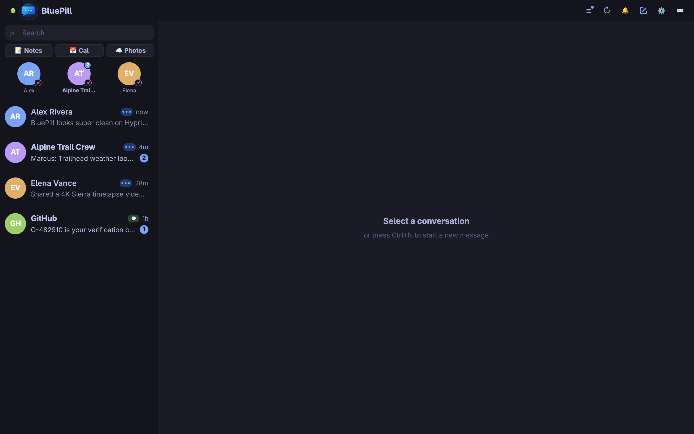
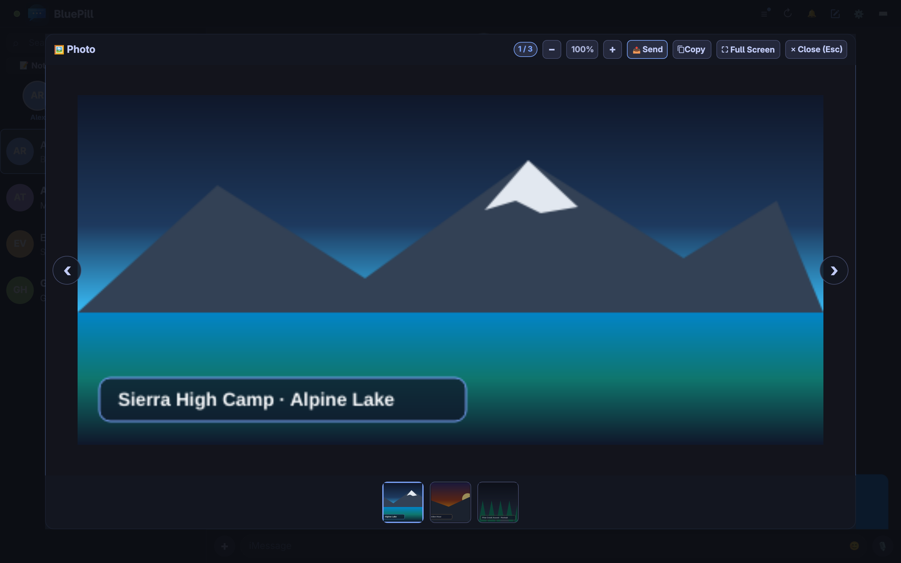
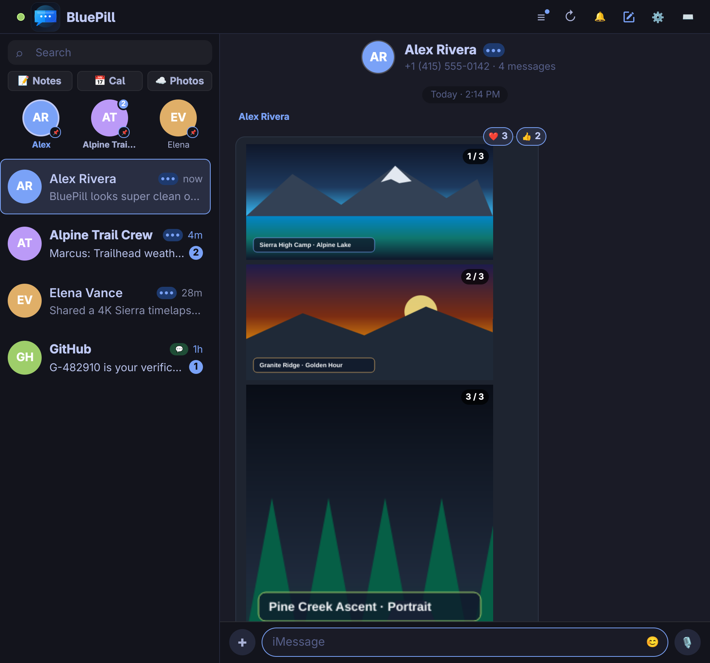

<p align="center">
  
</p>

<h1 align="center">BluePill — Native Linux Qt6/QML iMessage, RCS &amp; SMS Client + macOS Relay &amp; Web UI</h1>

<p align="center">
  <a href="https://github.com/nertwork/bluepill/actions/workflows/ci.yml"></a>
  <a href="https://github.com/nertwork/bluepill/releases/latest"></a>
  <a href="https://aur.archlinux.org/packages/bluepill"></a>
  <a href="https://github.com/nertwork/homebrew-tap"></a>
  <a href="https://coderabbit.ai"></a>
  <a href="https://github.com/nertwork/bluepill/graphs/contributors"></a>
  <a href="LICENSE"></a>
</p>

**`BluePill`** (`bluepill`, backward-compatible with `imsg`) is a complete, open-source **iMessage, RCS, and SMS ecosystem for Linux and macOS** consisting of three unified interfaces:

1. **Native Linux Desktop Client (`bluepill` / `yay -S bluepill`):** A fast (~48 MB RSS), zero-Electron, zero-Flutter **C++20 and Qt6/QML** desktop application for Wayland / Hyprland / [Omarchy](https://omarchy.org) / X11 with **0ms local cache startup**, real-time **Socket.IO v4 push**, **Pinned Conversations**, **1-click 2FA OTP copy pills**, **built-in Photo Lightbox**, and live Omarchy theme hot-reloading.
2. **Headless macOS Relay Daemon (`bluepill-server` / `brew install nertwork/tap/bluepill`):** A lightweight (~18 MB RSS), zero-Electron macOS daemon that reads `~/Library/Messages/chat.db` directly in SQLite WAL mode (`<2ms` queries), decodes `attributedBody` typedstreams natively, resolves `AddressBook` contacts in `<5ms`, and supports both **Full `IMCore` Private API mode** (instant tapbacks, unsend, edit, delete, background read receipts) and **Zero-SIP `osascript` Gateway mode** — while remaining **100% API-compatible with legacy BlueBubbles Server (`1.9.x`)**.
3. **Built-In BluePill Web UI (`http://<mac-relay>:1235/web` or `bluepill --webui`):** A zero-install, dark-mode browser client served directly by `bluepill-server` so you can read, search, react, and send iMessages, SMS, and RCS from any browser on your tailnet or LAN.

---

## Screenshots

### Active Conversation — Pinned Chats Bar, Multi-Photo Gallery, Tapbacks, Edited/Confetti Badges & 1-Click 2FA OTP Copy Pill


### BluePill Home Dashboard — Sync Window Presets, Web UI Launcher, Server Setup & Unread Summary


### Built-In Full-Window Photo Lightbox & Gallery Viewer


### Responsive 50% Tiled Split-Window Layout (`920x860`)


---

## Quick Start Installation

### 1. macOS Relay Setup (`bluepill-server` via Homebrew — Recommended)

On any Mac signed into your Apple ID (`Messages.app`):

```bash
brew tap nertwork/tap
brew install nertwork/tap/bluepill
bluepill-server init
brew services start bluepill
```

- **Verify Relay & Web UI:**
  - Health / Info API: `curl -s http://127.0.0.1:1235/api/v1/server/info`
  - Built-In Web UI: Open `http://127.0.0.1:1235/web` in any browser (or over Tailscale / HTTPS reverse proxy).
- **100% Legacy BlueBubbles Compatible:** Already running `BlueBubbles.app` (`v1.9.x`)? `BluePill` on Linux connects to existing BlueBubbles servers out of the box with zero server changes required.

### 2. Linux Desktop Client & CLI Setup (`bluepill` via AUR)

On Arch Linux / Omarchy Linux (`x86_64` & `aarch64`):

```bash
yay -S bluepill
# Launch the GUI (press Ctrl+, to open the ⚙ Settings modal)
bluepill
# Or launch the Built-In Web UI in your default browser
bluepill --webui
```

---

## Key Features

- **Pinned Conversations Bar:** Syncs pinned threads from macOS (`com.apple.messages.pinning.plist`) or lets you right-click any conversation to pin/unpin circular avatar tiles at the top of the sidebar.
- **1-Click 2FA / OTP Verification Code Copy (`󰆏 Copy Code: 482910`):** Automatically extracts 4–8 digit verification codes and `G-XXXXXX` tokens from incoming SMS/iMessage texts (while ignoring years, phone numbers, and prices) and renders a 1-click copy pill inside the message bubble.
- **iOS-Style Inline Media:** Photos keep their aspect ratio (scaled down, never cropped), GIFs and WebP animate inline and in the Photo Lightbox, and photos or one to three emoji sent without text are shown on their own, without a bubble.
- **Edited, Expressive Send Effects & Delivery Failure Badges:** Displays `"· Edited"`, `"· sent with confetti / slam / lasers"`, and red `"⚠ Not Delivered"` indicators directly on message bubbles.
- **Non-Blocking Clipboard Image Copy (`󰆏 Copy Image` / Right-Click / `Ctrl+C`) & Instant Paste (`Ctrl+V`):**
  - Copy any photo from a message bubble (`󰆏 Copy Image` in the action bar, right-click on the bubble or inline photo card, or `󰆏 Copy Image` / `Ctrl+C` in the Photo Lightbox) with `<0.5ms` GUI-thread response via header-only validation (`QImageReader::canRead()`), local `file://` URL staging (`m_lastCopiedImagePath`), and asynchronous background `QThreadPool` PNG encoding (`QImageWriter` compression level 1 piped to `wl-copy --type image/png`).
  - Paste images across conversations (`Ctrl+V` or `Shift+Insert` in the message composer) using a `<0.1ms` zero-copy fast-path for in-app/local image files and direct raw byte stream writes for external Wayland screenshots (`wl-paste`).
- **Clickable Scheme-Less SMS Shortlinks & Rich Multi-Paragraph Formatting:** Automatically linkifies both full `https://` URLs and scheme-less SMS/carrier domain links (e.g., `youngla.attn.tv/...`, `bit.ly/...`, `www.example.com/...`) while preserving `
` paragraph breaks as `<br/>` and opening links with debounced `Backend::openUrl()` (`QDesktopServices` + `xdg-open` fallback).
- **Strict Per-Chat Optimistic Send & Off-Thread Cache Architecture:**
  - Optimistic `temp-*` and synthetic local items (`local-note-*`, `local-cal-*`) are strictly isolated to their originating `chatGuid` across `m_messages`, `m_chatMessagesCache`, and `messages_cache.json`, preventing cross-conversation bleeding.
  - Periodic message cache persistence (`flushMessagesCacheNow`) snapshots implicitly-shared `QHash`/`QList` containers in `<0.05ms` and performs all sorting, `attributedBody` extraction, JSON serialization, and atomic disk writes on a background `QThreadPool` worker.
- **Three Flexible Transports:**
  - **BluePill Native macOS Relay (`https://...` or `http://...:1235`)** — `<18 MB` headless daemon + built-in Web UI. **⚙ Settings** finds relays on your Tailscale network automatically, defaults to `http://`, and has a separate **Port** field (default `1235`).
  - **Legacy BlueBubbles Server (`https://...`)** — 100% backward-compatible with `BlueBubbles.app` + `BlueBubblesHelper.dylib`.
  - **Direct SSH Mode (`ssh://user@mac-host`)** — Key-based SSH transport with zero password required.
- **Optional iCloud Hub Modules (Notes, Calendar & Photos.app Gallery) + Homebrew Preflight CLI:**
  - All three iCloud Hub modules (`📝 Notes`, `📅 Calendar`, `☁️ Photos`) are enabled by default for full testing and can be individually enabled or disabled at any time in **`⚙ Settings` (`Ctrl+,`) -> iCloud Hub Modules (Optional)**, via environment variables (`BLUEPILL_ENABLE_NOTES=0/1`, `BLUEPILL_ENABLE_CALENDAR=0/1`, `BLUEPILL_ENABLE_PHOTOS=0/1`), or via `bluepill-server` CLI flags (`--enable-notes` / `--disable-notes`, `--enable-calendar` / `--disable-calendar`, `--enable-photos` / `--disable-photos`).
  - **Read/Write iCloud & Local Hub Notes** with an in-place editor + full-screen Pop Out modal, HTML rendering, rich preview, and attachment downloads.
  - **Paginated & Full-Screen (`⛶ Full Screen`) iCloud Photos, Notes & Calendar** with customizable `24 / 60 / 120` items per page selector, custom scrollbar, and page navigator.
  - Full local macOS **Photos.app** library browser with instant preview, zoom, copy, and download, plus Apple **Calendar** events with schedule and day agendas.
  - `bluepill-server preflight` verifies macOS Full Disk Access for `NoteStore.sqlite`, `Calendar.sqlitedb`, and `Photos.sqlite`, and automatically enables/kickstarts `com.apple.photolibraryd` and `com.apple.cloudphotod` on macOS so iCloud `Photos.app` library assets and derivatives stay synced.
- **Customizable Notifications, 6 Audio Ding Presets & Top-Left Red/Green Connection Indicator:**
  - Eliminates spurious startup/historical/self-echo audio alerts via startup baseline (`m_initialSyncComplete`, `m_startupTimestamp`, `m_startupHighestRowId`), persistent `notifiedMessageGuids` in `state.json`, and active-chat focus mute (`notificationMuteWhenActive`).
  - Configurable in **`⚙ Settings` (`Ctrl+,`) -> Notifications & Audio Ding** with toggles for **Desktop Banner**, **Audio Ding**, and **Mute Focused Chat**, **6 built-in synthesized `.wav` presets** (`Classic Chime`, `Crystal Ding`, `Tri-Tone Marimba`, `Soft Pop`, `Glass Ping`, `System Tone`), **`🔊 Preview Ding`**, and **`🔔 Test Alert`**.
  - Top-left connection dot (and optional `showTopBarStatusPill` status pill) turn **Red (`Disconnected`)** immediately when offline and **Green (`Connected`)** when online, while **`⚙ Settings` (`Ctrl+,`)** includes a live **Client/Relay Version Banner**, **Server & Sync / UI & Appearance / Notifications & Audio** section tabs, configurable **4-slot Pinned Row Recent Backfill** (`pinnedRowFillRecent`), sidebar **`📌` Pin/Unpin** hover action with tooltips on all 4 hover actions, **Hover Tapback Action Bar** (`hoverMessageActions`), and **`➕` Custom Emoji Tapbacks**.
- **High-Contrast Darker Emerald RCS Sent Bubbles (`#1B5E3A`):** Vivid contrast and WCAG AA legibility for sent RCS messages against dark backgrounds, paired with `<0.5ms` non-blocking async clipboard image copy/paste.
- **Full Headless JSON CLI (`bluepill`, `imsg` & `bluepill-server`):**
  ```bash
  bluepill status --json
  bluepill recent --limit 10 --json
  bluepill send "+14155550142" "Hello from BluePill CLI" --json
  bluepill-server preflight --json
  bluepill-server doctor
  bluepill --webui
  ```

---

## Configuring Your Endpoint, Apple Account & Relay Settings

1. **Sign into Apple Messages on your Mac:** Open `Messages.app`, sign in with your Apple Account, and (optionally, for SMS/RCS) enable **Settings → Apps → Messages → Text Message Forwarding** on your iPhone.
2. **Grant Full Disk Access & Start the Relay:** Enable **Full Disk Access** for your terminal / Python under **System Settings → Privacy & Security → Full Disk Access**, then run `bluepill-server init` and `brew services start bluepill` (config stored in `~/.config/bluepill/server.json`).
3. **Connect Your Linux Desktop Client:** Launch `bluepill` and press **`Ctrl+,`** (or click **`⚙ Settings`**) to enter your **Primary Server URL** (`http://<mac-ip>:1235`, `https://your-relay.example.com`, or Direct SSH `ssh://user@mac-host`), optional **Failover URL**, and **API Password**, or pre-configure `~/.config/bluepill/config.json` (`0600`) or environment variables (`BLUEPILL_SERVER_URL`, `BLUEPILL_PASSWORD`).

### Local Database & Credential Privacy

- **Your Data Stays on Your Hardware:** `bluepill-server` reads `~/Library/Messages/chat.db` and `AddressBook` directly on your own Mac in read-only SQLite WAL mode (`?mode=ro`) with zero third-party cloud relays or Firebase push dependencies.
- **Owner-Only Credentials & Keyring Support:** On Linux, `~/.config/bluepill/config.json` enforces `0600` (`-rw-------`) permissions, Freedesktop Secret Service (`libsecret` / `secret-tool`) integration is built in, local message caching resides solely in `~/.cache/imsg/`, and all HTTPS/Socket.IO requests enforce `QSslSocket::VerifyPeer`.
- **Safe Diagnostics:** `bluepill status --json` and `bluepill doctor` automatically mask passwords and session tokens.

---

## Platform Compatibility Matrix

`BluePill` is developed, continuously tested in CI, and verified across the following OS and architecture targets:

| Component | Operating System | CPU Architectures | Display / Runtime Stack | Package / Distribution |
| :--- | :--- | :--- | :--- | :--- |
| **BluePill Linux Desktop & CLI (`bluepill`)** | Arch Linux, Omarchy Linux, and modern Linux distributions | `x86_64`, `aarch64` (ARM64) | Wayland (Hyprland, Sway, KDE, GNOME) & X11 · Qt 6.8+ / C++20 · PipeWire · `libnotify` | **AUR:** `yay -S bluepill`<br>**Source:** `./bin/build && ./bin/install` |
| **BluePill macOS Relay Daemon (`bluepill-server`)** | macOS Sequoia (`15.x`), Sonoma (`14.x`), Ventura (`13.x`), Tahoe (`26.x`) | `arm64` (Apple Silicon) & `x86_64` (Intel / KVM Virtual Machines) | Python 3.11+ · SQLite 3 WAL (`chat.db` + `AddressBook`) · `IMCore` Private API or Zero-SIP `osascript` | **Homebrew:** `brew install nertwork/tap/bluepill`<br>**LaunchAgent:** `brew services start bluepill` |
| **BluePill Web UI (`/web`)** | Cross-Platform (Linux, macOS, Windows, iOS, Android) | Any | Modern Web Browser (HTML5 / Fetch / EventSource & Socket.IO) | Built into `bluepill-server` (`http://<host>:1235/web`) |

---

## Documentation & Guides

- **[Complete Installation & Operations Guide](docs/INSTALLATION_AND_OPERATIONS_GUIDE.md)** — Production installation on Arch Linux, Omarchy, Debian, Ubuntu, Fedora, NixOS, macOS Relay, Web UI, and full REST & RPC API specification.
- **[AI Agent Installation Playbook](docs/AGENT_INSTALL_PLAYBOOK.md)** — Non-interactive, copy-pasteable autonomous agent workflows with explicit timeouts and automated verification.
- **[Autonomous Agent Instructions (AGENTS.md)](AGENTS.md)** — Canonical operational prompts and autonomous execution rules for Claude Code, OpenCode, Gemini CLI, Codex, Cursor, and Antigravity.
- **[macOS Relay & BlueBubbles Setup Guide](docs/BLUEBUBBLES_SETUP_GUIDE.md)** — Installing `bluepill-server` via Homebrew on macOS, using the Built-In Web UI, or connecting to a legacy BlueBubbles Server.
- **[Configuration, Transports & CLI Reference](docs/CONFIGURATION_AND_CLI.md)** — Configuring HTTPS, Failover URLs, Direct SSH (`ssh://`), Linux Secret Service (`libsecret`), and JSON CLI automation.
- **[Architecture & Internals](docs/ARCHITECTURE.md)** — How the C++20/Qt6 client, SQLite WAL `bluepill-server` daemon, `IMCore` TCP bridge, and Socket.IO v4 push pipeline work under the hood.
- **[Contributing Guide](CONTRIBUTING.md)** — Building from source, running the 66 offscreen unit tests (`./bin/test`), and submitting Pull Requests reviewed by `@coderabbitai` and Arch Linux CI.

---

## CI/CD & Automated Verification

Every commit and Pull Request on `nertwork/bluepill` is verified by GitHub Actions across Linux and packaging targets:

- **`Lint, Syntax & Security Audit`:** Validates linked issue metadata, runs the **Security & Configuration Hygiene** credential/placeholder scan, compiles and runs `python3 server/bluepill_server.py --selftest`, and syntax-checks `bin/build`, `bin/test`, and `Formula/bluepill.rb`.
- **`Arch Linux Build, Unit Tests & Package`:** Builds `bluepill` (C++20 / Qt6) inside `archlinux:latest`, runs the full offscreen QtTest suite (`QT_QPA_PLATFORM=offscreen ./bin/test`), verifies offscreen `--demo-screenshot` rendering, and builds the Arch Linux package with `makepkg`.
- **`Static Analysis (cppcheck / qmllint) & CodeRabbit-Style AI Review`:** Runs `cppcheck --library=qt` and Qt6 `qmllint` on every PR and posts a detailed walkthrough.
- **`Documentation Sync (gh-pages)` & `Release`:** Automatically publishes updated docs to [GitHub Pages](https://nertwork.github.io/bluepill/) on `main`, and builds Arch `.pkg.tar.zst` archives plus Homebrew universal bottles (`bluepill-*.all.bottle.tar.gz`) on version tags (`v*`).

---

## Community & Contributors

Thank you to everyone contributing code, bug reports, testing, and platform improvements to **BluePill**!

- **[@nertwork](https://github.com/nertwork) (James Farr Gomez)** — Creator & Maintainer (C++20/Qt6 Linux client, macOS `bluepill-server` relay, `IMCore` bridge, Web UI, Arch AUR & Homebrew packaging).
- **[@JosephGottlieb](https://github.com/JosephGottlieb) (Joseph Gottlieb)** — macOS 26 (`any;` chat GUID) iMessage/RCS/SMS service resolution ([#36](https://github.com/nertwork/bluepill/pull/36) / [#28](https://github.com/nertwork/bluepill/issues/28)), Server Setup Port field & Tailscale relay discovery ([#35](https://github.com/nertwork/bluepill/pull/35) / [#29](https://github.com/nertwork/bluepill/issues/29) / [#30](https://github.com/nertwork/bluepill/issues/30)), in-place photo timeline resolution without list resets ([#42](https://github.com/nertwork/bluepill/pull/42) / [#44](https://github.com/nertwork/bluepill/issues/44)), confirmed message Edit/Unsend within 2-minute window & right-click action bar ([#55](https://github.com/nertwork/bluepill/pull/55) / [#49](https://github.com/nertwork/bluepill/issues/49)), Contact Info card, full macOS AddressBook fields & circular contact photos ([#56](https://github.com/nertwork/bluepill/pull/56) / [#50](https://github.com/nertwork/bluepill/issues/50)), link-preview image decoding validation ([#58](https://github.com/nertwork/bluepill/pull/58) / [#52](https://github.com/nertwork/bluepill/issues/52)), inline quoted-reply Thread View & Jump-to-Original ([#59](https://github.com/nertwork/bluepill/pull/59) / [#53](https://github.com/nertwork/bluepill/issues/53)), and macOS pinned conversations sync & context menu Pin/Unpin ([#60](https://github.com/nertwork/bluepill/pull/60) / [#54](https://github.com/nertwork/bluepill/issues/54)).

See the full **[GitHub Contributors Graph](https://github.com/nertwork/bluepill/graphs/contributors)** and our **[Contributing Guide](CONTRIBUTING.md)** to get involved.

---

## License

Released under the [MIT License](LICENSE).
