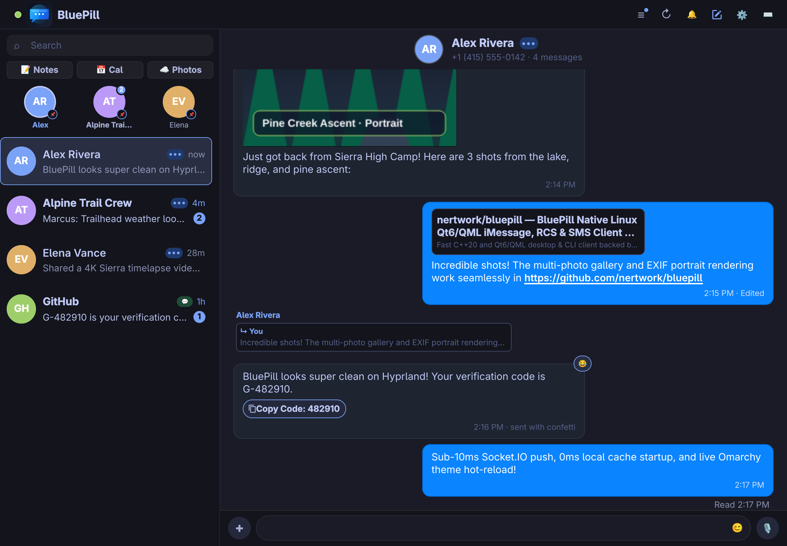

<p align="center">
  
</p>

<h1 align="center">BluePill — Native Qt6 iMessage, RCS &amp; SMS Client + Cloud Relay &amp; Web UI</h1>

<p align="center">
  <strong>Official Website:</strong> <a href="https://bluepill.nertwork.com"><strong>https://bluepill.nertwork.com</strong></a> ·
  <strong>Live Interactive Demo:</strong> <a href="https://bluepill.nertwork.com/demo"><strong>Try Live Demo</strong></a> ·
  <strong>Free Cloud Relay Signup:</strong> <a href="https://bluepill.nertwork.com/signup"><strong>Sign Up Free</strong></a> ·
  <strong>Support Open-Source Development:</strong> <a href="https://github.com/sponsors/nertwork"><strong>❤️ Sponsor on GitHub</strong></a> · <a href="https://bluepill.nertwork.com/#support"><strong>Sponsor BluePill</strong></a>
</p>

<p align="center">
  <em>Sponsorships fund the Apple Developer Program ($99/yr), Windows Code-Signing certificates, and Cloud Relay edge infrastructure.</em>
</p>

<p align="center">
  <a href="https://github.com/nertwork/bluepill/releases/latest"><strong>Downloads (.exe / .deb / .rpm)</strong></a> ·
  <a href="https://bluepill.nertwork.com/docs"><strong>Documentation</strong></a> ·
  <a href="mailto:support@nertwork.com"><strong>support@nertwork.com</strong></a>
</p>

<p align="center">
  <a href="https://github.com/sponsors/nertwork"></a>
  <a href="https://github.com/nertwork/bluepill/actions/workflows/ci.yml"></a>
  <a href="https://github.com/nertwork/bluepill/releases/latest"></a>
  <a href="https://aur.archlinux.org/packages/bluepill-bin"></a>
  <a href="https://github.com/nertwork/homebrew-tap"></a>
  <a href="https://coderabbit.ai"></a>
  <a href="https://github.com/nertwork/bluepill/graphs/contributors"></a>
  <a href="LICENSE"></a>
</p>

**`BluePill`** (`bluepill`, backward-compatible with `imsg`) is a complete, open-source **iMessage, RCS, and SMS ecosystem for Linux, Windows, macOS, and the Web** consisting of three unified interfaces:

1. **Native Linux & Windows Desktop Client (`bluepill`):** A fast (~48 MB RSS), zero-Electron, zero-Flutter **C++20 and Qt6/QML** desktop application for **Linux** (Arch/Omarchy AUR, Debian/Ubuntu `.deb`, Fedora/RHEL `.rpm`) and **Windows** (`BluePill-Setup-*.exe`) with **0ms local cache startup**, real-time **Socket.IO v4 push**, **Pinned Conversations**, **1-click 2FA OTP copy pills**, **built-in Photo Lightbox**, and live Omarchy theme hot-reloading.
2. **Headless macOS Relay Daemon (`bluepill-server` / `brew install nertwork/tap/bluepill`):** A lightweight (~18 MB RSS), zero-Electron macOS daemon that reads `~/Library/Messages/chat.db` directly in SQLite WAL mode (`<2ms` queries), decodes `attributedBody` typedstreams natively, resolves `AddressBook` contacts in `<5ms`, includes **built-in BluePill Cloud Relay** (`wss://api.bluepill.nertwork.com/tunnel/connect`, zero port-forwarding), and supports both **Full `IMCore` Private API mode** and **Zero-SIP `osascript` Gateway mode** — while remaining **100% API-compatible with legacy BlueBubbles Server (`1.9.x`)**.
3. **Unified BluePill Web Client (`http://<mac-relay>:1235/web`, `https://bluepill.nertwork.com/t/<slug>/web`, or `https://bluepill.nertwork.com/demo`):** A zero-install, single-file browser client with **Liquid Glass / Matrix / Light** theme switching, **auto-populated relay credentials when signed in**, **3-column pinned chats grid**, **contact resolution & `lastMessage` conversation previews**, **lazy-loaded Photos**, **inline `<audio>` / `<video>` playback with server-side `.caf` (`audio/x-caf`) transcoding (`?transcode=1`)**, **auto-retry + `↻ Resend`**, unified **Messages, Notes, Calendar, Photos, and Contacts** tabs, inline tapbacks, 1-click 2FA OTP copy pills, real-time Socket.IO updates, and hardened XSS/CSP/`Cache-Control: no-store, private`/cookie isolation.

---

## Screenshots

### Active Conversation — Upper-Corner Tapbacks, Multi-Photo Gallery, 1-Click 2FA OTP & Sleek Pill Composer


### Clean Home View & Quick Conversation Launcher (`Ctrl+N`)


### Decluttered Proportional Photo Lightbox & Thumbnail Strip


### Responsive 50% Tiled Split-Window Layout (`920x860` logical / `1840x1720` HiDPI)


---

## Quick Start Installation

### 1. macOS Relay Setup (`bluepill-server` via Homebrew + BluePill Cloud)

On any Mac signed into your Apple ID (`Messages.app`):

```bash
brew install nertwork/tap/bluepill
bluepill-server login   # Opens https://bluepill.nertwork.com/portal to link your Mac
brew services start bluepill
```

- **Verify Relay, Cloud Relay & Web UI:**
  - Cloud Relay Status: `bluepill-server relay-status`
  - Cloud Managed Updates (BluePill Cloud Perk): `bluepill-server update-status` / `bluepill-server update --confirm` (or 1-click confirmation inside the desktop client UI — strictly gated to signed-in `bluepill.nertwork.com` users; never phones home when self-hosted offline). Mac server updates use LaunchAgent-aware restarts (`launchctl kickstart -k` for `com.nertwork.bluepill-server` / `homebrew.mxcl.bluepill`) and automatically fall back to SHA256-verified GitHub release bottles (`bluepill-<ver>.all.bottle.tar.gz`) if Homebrew lacks `git`/Xcode CLT or the tap lags.
  - Smart Direct Cross-Platform Client Auto-Updates: Signed-in desktop clients verify release `SHA256SUMS.txt` over an HTTPS allowlist (`github.com`, `objects.githubusercontent.com`, `release-assets.githubusercontent.com`, `bluepill.nertwork.com`) and apply updates directly — silent Inno Setup (`/VERYSILENT /SUPPRESSMSGBOXES /NORESTART /CLOSEAPPLICATIONS /NORESTARTAPPLICATIONS`) on Windows, `pkexec pacman -U` (or `yay`/`paru` for `bluepill-bin`) on Omarchy/Arch, `pkexec apt-get install` on Debian/Ubuntu, and `pkexec dnf install` on Fedora/RHEL (with terminal `sudo` fallback when no polkit agent is active).
  - Health / Info API: `curl -s http://127.0.0.1:1235/api/v1/server/info`
  - Built-In Web UI: Open `http://127.0.0.1:1235/web` (or your hosted Cloud Relay Web UI at `https://bluepill.nertwork.com/t/<slug>/web`).
  - Try instantly without a Mac: **[Live Interactive Demo](https://bluepill.nertwork.com/demo)** or click **"Try Live Demo"** inside the desktop client.
- **100% Legacy BlueBubbles Compatible:** Already running `BlueBubbles.app` (`v1.9.x`)? `BluePill` connects to existing BlueBubbles servers out of the box with zero server changes required.

### 2. Desktop Client & CLI Setup (Linux & Windows)

- **Arch Linux / Omarchy (`x86_64`):** `yay -S bluepill-bin` *(fast prebuilt binary, ~4s install; or `yay -S bluepill` to compile from source on `x86_64`/`aarch64`)*
- **Debian / Ubuntu (`.deb`):** Download `bluepill_<version>_amd64.deb` from **[GitHub Releases](https://github.com/nertwork/bluepill/releases/latest)** (`sudo apt install ./bluepill_*.deb`)
- **Fedora / RHEL (`.rpm`):** Download `bluepill-<version>-1.x86_64.rpm` from **[GitHub Releases](https://github.com/nertwork/bluepill/releases/latest)** (`sudo dnf install ./bluepill-*.rpm`)
- **Windows (`x86_64` `.exe` — Per-User Standalone, No Admin Required):** Download `BluePill-Setup-<version>-win64.exe` from **[GitHub Releases](https://github.com/nertwork/bluepill/releases/latest)** (~53 MB; installs to `%LOCALAPPDATA%\Programs\BluePill` like VS Code User Setup with silent zero-UAC auto-updates, native in-process `Qt6::Multimedia` audio playback, and optional settings cleanup on uninstall)

```bash
# Launch the GUI — click "Sign in at bluepill.nertwork.com →" (default) or "Try Live Demo"
bluepill
# Or launch the Built-In Web UI in your default browser
bluepill --webui
```

---

## Key Features

- **Pinned Conversations Bar:** Syncs pinned threads from macOS (`com.apple.messages.pinning.plist`) or lets you right-click any conversation to pin/unpin circular avatar tiles at the top of the sidebar.
- **1-Click 2FA / OTP Verification Code Copy (`󰆏 Copy Code: 482910`):** Automatically extracts 4–8 digit verification codes and `G-XXXXXX` tokens from incoming SMS/iMessage texts (while ignoring years, phone numbers, and prices) and renders a 1-click copy pill inside the message bubble.
- **iOS-Style Inline Media, Multi-Image Queuing & Proportional Viewers:** Photos keep their aspect ratio (scaled down, never cropped), GIFs and WebP animate inline and in the decluttered, proportionally sized Photo Lightbox, and photos or 1–3 emoji sent without text render cleanly without a bubble. Queue multiple pasted/attached images or embed iCloud/iMessage Photos directly in the composer (`sendAttachments()`), and browse Notes and Calendar in proportionally sized modal viewers.
- **Right-Click Tapbacks, Upper-Corner Reactions & Multi-Message Selection:** Right-click any message bubble or photo to open the macOS Messages-style context popover (`❤️ 👍 👎 😂 ‼️ ❓ ➕` custom emoji picker, Reply, Edit, Copy / Copy Image, Copy Code, Unsend, Delete); reaction pills anchor cleanly to the upper-left (sent) / upper-right (received) corner of bubbles. Select multiple messages with `Ctrl+Click` or `Shift+Click` and press `Ctrl+C` (or **Copy** / **Copy with Names**) to copy them chronologically.
- **Expressive Send Effects (`Slam`, `Loud`, `Gentle`, `Invisible Ink`, `Confetti`, `Lasers`, `Fireworks`, `Echo`):** Right-click the Send (`↑`) button or choose **Send with Effect** to send immediately or arm a dismissible effect pill (`✨ Sending with <Effect>`) above the composer, with full-viewport animations, click-to-reveal Invisible Ink, `"· Edited"` and `"· sent with ..."` indicators, and red `"⚠ Not Delivered"` alerts.
- **Multi-Recipient Group Chat Creation & Compact Service Badges:** Start new 1:1 or group threads (`Ctrl+N`) using the chip/token `To:` bar (`Enter`, comma, or autocomplete click adds removable recipient chips; `Backspace` removes the last chip) backed by `POST /api/v1/chat/new`, with compact iMessage/SMS symbol badges in the sidebar and headers.
- **Composer Spell Check, Custom Dictionary & macOS Grammar Assist:** Real-time spell-check underlines, right-click spelling suggestions, custom dictionary persistence (`~/.config/bluepill/dictionary.txt`), and macOS relay `NSSpellChecker` grammar/auto-suggest chips (`POST /api/v1/text/check`), all toggleable in **⚙ Settings → Appearance**.
- **Native Audio Waveforms & Windows Voice Memo Recording (`Qt6::Multimedia`):** Renders interactive 28-bar voice memo waveforms across Linux and Windows (`Qt6::Multimedia` + bundled `ffmpeg.exe`) with in-process voice memo recording on Windows, Linux, and macOS.
- **Non-Blocking Clipboard Image Copy (`󰆏 Copy Image` / Right-Click / `Ctrl+C`) & Instant Paste (`Ctrl+V`):**
  - Copy any photo from a message bubble (`󰆏 Copy Image` in the right-click menu, right-click on an inline photo card, or `Copy` / `Ctrl+C` in the Photo Lightbox) with `<0.5ms` GUI-thread response via header-only validation (`QImageReader::canRead()`), local `file://` URL staging (`m_lastCopiedImagePath`), and asynchronous background `QThreadPool` PNG encoding (`QImageWriter` compression level 1 piped to `wl-copy --type image/png`).
  - Paste and queue images across conversations (`Ctrl+V` or `Shift+Insert` in the message composer) using a `<0.1ms` zero-copy fast-path for in-app/local image files and direct raw byte stream writes for external Wayland screenshots (`wl-paste`).
- **Clickable Scheme-Less SMS Shortlinks & Rich Multi-Paragraph Formatting:** Automatically linkifies both full `https://` URLs and scheme-less SMS/carrier domain links (e.g., `youngla.attn.tv/...`, `bit.ly/...`, `www.example.com/...`) while preserving `
` paragraph breaks as `<br/>` and opening links with debounced `Backend::openUrl()` (`QDesktopServices` + `xdg-open` fallback).
- **Strict Per-Chat Optimistic Send & Off-Thread Cache Architecture:**
  - Optimistic `temp-*` and synthetic local items (`local-note-*`, `local-cal-*`) are strictly isolated to their originating `chatGuid` across `m_messages`, `m_chatMessagesCache`, and `messages_cache.json`, preventing cross-conversation bleeding.
  - Periodic message cache persistence (`flushMessagesCacheNow`) snapshots implicitly-shared `QHash`/`QList` containers in `<0.05ms` and performs all sorting, `attributedBody` extraction, JSON serialization, and atomic disk writes on a background `QThreadPool` worker.
- **Three Flexible Transports:**
  - **BluePill Native macOS Relay (`https://...` or `http://...:1235`)** — `<18 MB` headless daemon + built-in Web UI. **⚙ Settings** finds relays on your Tailscale network automatically, defaults to `http://`, and has a separate **Port** field (default `1235`).
  - **Legacy BlueBubbles Server (`https://...`)** — 100% backward-compatible with `BlueBubbles.app` + `BlueBubblesHelper.dylib`.
  - **Direct SSH Mode (`ssh://user@mac-host`)** — Key-based SSH transport with zero password required.
- **Optional iCloud Hub Modules (Notes, Calendar & Photos.app Gallery) + Homebrew Preflight CLI:**
  - All three iCloud Hub modules (`📝 Notes`, `📅 Calendar`, `☁️ Photos`) are enabled by default for full testing and can be individually enabled or disabled at any time in **`⚙ Settings` (`Ctrl+,`) -> iCloud Hub Modules (Optional)**, via environment variables (`BLUEPILL_ENABLE_NOTES=0/1`, `BLUEPILL_ENABLE_CALENDAR=0/1`, `BLUEPILL_ENABLE_PHOTOS=0/1`), or via `bluepill-server` CLI flags (`--enable-notes` / `--disable-notes`, `--enable-calendar` / `--disable-calendar`, `--enable-photos` / `--disable-photos`).
  - **Read/Write iCloud & Local Hub Notes** with an in-place editor + full-screen Pop Out modal, HTML rendering, rich preview, and attachment downloads.
  - **Paginated & Full-Screen (`⛶ Full Screen`) iCloud Photos, Notes & Calendar** with customizable `24 / 60 / 120` items per page selector, custom scrollbar, and page navigator.
  - Full local macOS **Photos.app** library browser with instant preview, zoom, copy, and download, plus Apple **Calendar** events with schedule and day agendas.
  - `bluepill-server preflight` verifies macOS Full Disk Access for `NoteStore.sqlite`, `Calendar.sqlitedb`, and `Photos.sqlite`, and automatically enables/kickstarts `com.apple.photolibraryd` and `com.apple.cloudphotod` on macOS so iCloud `Photos.app` library assets and derivatives stay synced.
- **Customizable Notifications, System Tray, Auto-Updates & Calm Collapsible Settings:**
  - Eliminates spurious startup/historical/self-echo audio alerts via startup baseline (`m_initialSyncComplete`, `m_startupTimestamp`, `m_startupHighestRowId`), persistent `notifiedMessageGuids` in `state.json`, and active-chat focus mute (`notificationMuteWhenActive`).
  - Configurable in **`⚙ Settings` (`Ctrl+,`) -> Notifications** with toggles for **Desktop Banner**, **Audio Ding**, **Mute Focused Chat**, **Minimize to Tray on Close** (`minimizeToTrayOnClose`, default ON; use `Ctrl+Q` or tray **Quit** to exit), single-instance window wake, click-to-focus desktop notifications, and **6 built-in synthesized `.wav` presets** (`Classic Chime`, `Crystal Ding`, `Tri-Tone Marimba`, `Soft Pop`, `Glass Ping`, `System Tone`).
  - Top-left connection dot turns **Red (`Disconnected`)**, **Yellow (`Mac needs Full Disk Access`)** when `chat.db` permissions are missing on macOS (`503 chat_db_unreadable`), and **Green (`Connected`)** when online. **`⚙ Settings` (`Ctrl+,`)** displays a header version badge and keeps Connection, Appearance, and Notifications tidy with collapsed-by-default accordions (`iCloud Hub Modules`, `Updates`, `Self-Hosted & Advanced`, `Interface & Layout`, `Audio Devices & Advanced Alerts`). First-run launches also present a one-time onboarding wizard (`onboardingCompleted`).
  - **Auto-Updates ON by Default (Opt-Out Available):** Both the desktop client (`autoUpdateCheck`, including silent in-place Windows Inno Setup updates) and `bluepill-server` (`autoUpdate` in `~/.config/bluepill/server.json`, running on startup + every 6h) enable automatic update checks by default with explicit opt-out toggles (`BLUEPILL_AUTO_UPDATE=0` / `"autoUpdate": false` on macOS, or **Auto-Check Updates** in Settings).
- **High-Contrast Darker Emerald RCS Sent Bubbles (`#1B5E3A`):** Vivid contrast and WCAG AA legibility for sent RCS messages against dark backgrounds, paired with `<0.5ms` non-blocking async clipboard image copy/paste.
- **Full Headless JSON CLI (`bluepill`, `imsg` & `bluepill-server`):**
  ```bash
  bluepill status --json
  bluepill recent --limit 10 --json
  bluepill send "+14155550142" "Hello from BluePill CLI" --json
  bluepill-server preflight --json
  bluepill-server doctor
  bluepill --webui
  ```

---

## Configuring Your Endpoint, Apple Account & Relay Settings

1. **Sign into Apple Messages on your Mac:** Open `Messages.app`, sign in with your Apple Account, and (optionally, for SMS/RCS) enable **Settings → Apps → Messages → Text Message Forwarding** on your iPhone.
2. **Grant macOS Permissions & Start the Relay:** Under **System Settings → Privacy & Security**, enable:
   - **Full Disk Access** for Terminal / Homebrew Python (`chat.db`, Notes, Calendar, Photos)
   - **Automation → Messages** for Python / `bluepill-server` (required for sending when Private API is not enabled)
   Then run `brew services start bluepill` and verify with `bluepill-server doctor` (`Messages Automation: ok`).
3. **Connect Your Linux Desktop Client:** Launch `bluepill` and press **`Ctrl+,`** (or click **`⚙ Settings`**) to enter your **Primary Server URL** (`http://<mac-ip>:1235`, `https://your-relay.example.com`, or Direct SSH `ssh://user@mac-host`), optional **Failover URL**, and **API Password**, or pre-configure `~/.config/bluepill/config.json` (`0600`) or environment variables (`BLUEPILL_SERVER_URL`, `BLUEPILL_PASSWORD`).

### Local Database & Credential Privacy

- **Your Data Stays on Your Hardware:** `bluepill-server` reads `~/Library/Messages/chat.db` and `AddressBook` directly on your own Mac in read-only SQLite WAL mode (`?mode=ro`) with zero third-party cloud relays or Firebase push dependencies.
- **Owner-Only Credentials & Keyring Support:** On Linux, `~/.config/bluepill/config.json` enforces `0600` (`-rw-------`) permissions, Freedesktop Secret Service (`libsecret` / `secret-tool`) integration is built in, local message caching resides solely in `~/.cache/imsg/`, and all HTTPS/Socket.IO requests enforce `QSslSocket::VerifyPeer`.
- **Safe Diagnostics:** `bluepill status --json` and `bluepill doctor` automatically mask passwords and session tokens.

---

## Platform Compatibility Matrix

`BluePill` is developed, continuously tested in CI, and verified across the following OS and architecture targets:

| Component | Operating System | CPU Architectures | Display / Runtime Stack | Package / Distribution |
| :--- | :--- | :--- | :--- | :--- |
| **BluePill Desktop & CLI (`bluepill`)** | Arch/Omarchy, Debian/Ubuntu, Fedora/RHEL | `x86_64`, `aarch64` (ARM64) | Wayland (Hyprland, Sway, KDE, GNOME) & X11 · Qt 6.8+ (`Qt6::Multimedia`) / C++20 · PipeWire | **AUR:** `yay -S bluepill-bin` (prebuilt) / `yay -S bluepill` (source)<br>**Packages:** `.deb` & `.rpm` in [Releases](https://github.com/nertwork/bluepill/releases/latest) |
| **BluePill Windows Client (`bluepill.exe`)** | Windows 10 / 11 | `x86_64` | Native Qt 6.8 MSVC + Inno Setup Installer | **Installer:** `BluePill-Setup-*.exe` in [Releases](https://github.com/nertwork/bluepill/releases/latest) |
| **BluePill macOS Relay Daemon (`bluepill-server`)** | macOS Sequoia (`15.x`), Sonoma (`14.x`), Ventura (`13.x`), Tahoe (`26.x`) | `arm64` (Apple Silicon) & `x86_64` (Intel / KVM Virtual Machines) | Python 3.11+ · SQLite 3 WAL · Built-in Cloud Relay (`wss://`) · `IMCore` or `osascript` | **Homebrew:** `brew install nertwork/tap/bluepill`<br>**Cloud Login:** `bluepill-server login` |
| **BluePill Web Client (`/web` & Cloud Portal)** | Cross-Platform (Linux, macOS, Windows, iOS, Android) | Any | Liquid Glass / Matrix / Light UI · Zero External CDN · Socket.IO | Built into `bluepill-server` (`/web`) & **[bluepill.nertwork.com](https://bluepill.nertwork.com/demo)** |

---

## Documentation & Guides

- **[Complete Installation & Operations Guide](docs/INSTALLATION_AND_OPERATIONS_GUIDE.md)** — Production installation on Arch Linux, Omarchy, Debian, Ubuntu, Fedora, NixOS, macOS Relay, Web UI, and full REST & RPC API specification.
- **[AI Agent Installation Playbook](docs/AGENT_INSTALL_PLAYBOOK.md)** — Non-interactive, copy-pasteable autonomous agent workflows with explicit timeouts and automated verification.
- **[Autonomous Agent Instructions (AGENTS.md)](AGENTS.md)** — Canonical operational prompts and autonomous execution rules for Claude Code, OpenCode, Gemini CLI, Codex, Cursor, and Antigravity.
- **[macOS Relay & BlueBubbles Setup Guide](docs/BLUEBUBBLES_SETUP_GUIDE.md)** — Installing `bluepill-server` via Homebrew on macOS, using the Built-In Web UI, or connecting to a legacy BlueBubbles Server.
- **[Configuration, Transports & CLI Reference](docs/CONFIGURATION_AND_CLI.md)** — Configuring HTTPS, Failover URLs, Direct SSH (`ssh://`), Linux Secret Service (`libsecret`), and JSON CLI automation.
- **[Architecture & Internals](docs/ARCHITECTURE.md)** — How the C++20/Qt6 client, SQLite WAL `bluepill-server` daemon, `IMCore` TCP bridge, and Socket.IO v4 push pipeline work under the hood.
- **[Contributing Guide](CONTRIBUTING.md)** — Building from source, running the 66 offscreen unit tests (`./bin/test`), and submitting Pull Requests reviewed by `@coderabbitai` and Arch Linux CI.

---

## CI/CD & Automated Verification

Every commit and Pull Request on `nertwork/bluepill` is verified by GitHub Actions across Linux and packaging targets:

- **`Lint, Syntax & Security Audit`:** Validates linked issue metadata, runs the **Security & Configuration Hygiene** credential/placeholder scan, compiles and runs `python3 server/bluepill_server.py --selftest`, and syntax-checks `bin/build`, `bin/test`, and `Formula/bluepill.rb`.
- **`Arch Linux Build, Unit Tests & Package`:** Builds `bluepill` (C++20 / Qt6) inside `archlinux:latest`, runs the full offscreen QtTest suite (`QT_QPA_PLATFORM=offscreen ./bin/test`), verifies offscreen `--demo-screenshot` rendering, and builds the Arch Linux package with `makepkg`.
- **`Static Analysis (cppcheck / qmllint) & CodeRabbit-Style AI Review`:** Runs `cppcheck --library=qt` and Qt6 `qmllint` on every PR and posts a detailed walkthrough.
- **`Documentation Sync (gh-pages)` & `Release`:** Automatically publishes updated docs to [GitHub Pages](https://nertwork.github.io/bluepill/) on `main`, and builds Arch `.pkg.tar.zst` archives plus Homebrew universal bottles (`bluepill-*.all.bottle.tar.gz`) on version tags (`v*`).

---

## Community, Acknowledgments & Contributors

**Starting Point & Foundation:** BluePill began as a native Linux/Windows client built on top of the **[BlueBubbles](https://bluebubbles.app/)** protocol, `BlueBubblesHelper` Private API ecosystem, and open-source community. Huge credit and thanks to the [BlueBubbles](https://github.com/BlueBubblesApp) maintainers and contributors whose pioneering work made iMessage on non-Apple desktops possible — BluePill remains 100% API-compatible with BlueBubbles Server (`1.9.x`) in tribute to that foundation.

Thank you to everyone contributing code, bug reports, testing, and platform improvements to **BluePill**!

- **[@nertwork](https://github.com/nertwork) (James Farr Gomez)** — Creator & Maintainer (C++20/Qt6 Linux client, macOS `bluepill-server` relay, `IMCore` bridge, Web UI, Arch AUR & Homebrew packaging).
- **[@JosephGottlieb](https://github.com/JosephGottlieb) (Joseph Gottlieb)** — macOS 26 (`any;` chat GUID) iMessage/RCS/SMS service resolution ([#36](https://github.com/nertwork/bluepill/pull/36) / [#28](https://github.com/nertwork/bluepill/issues/28)), Server Setup Port field & Tailscale relay discovery ([#35](https://github.com/nertwork/bluepill/pull/35) / [#29](https://github.com/nertwork/bluepill/issues/29) / [#30](https://github.com/nertwork/bluepill/issues/30)), in-place photo timeline resolution without list resets ([#42](https://github.com/nertwork/bluepill/pull/42) / [#44](https://github.com/nertwork/bluepill/issues/44)), confirmed message Edit/Unsend within 2-minute window & right-click action bar ([#55](https://github.com/nertwork/bluepill/pull/55) / [#49](https://github.com/nertwork/bluepill/issues/49)), Contact Info card, full macOS AddressBook fields & circular contact photos ([#56](https://github.com/nertwork/bluepill/pull/56) / [#50](https://github.com/nertwork/bluepill/issues/50)), link-preview image decoding validation ([#58](https://github.com/nertwork/bluepill/pull/58) / [#52](https://github.com/nertwork/bluepill/issues/52)), inline quoted-reply Thread View & Jump-to-Original ([#59](https://github.com/nertwork/bluepill/pull/59) / [#53](https://github.com/nertwork/bluepill/issues/53)), and macOS pinned conversations sync & context menu Pin/Unpin ([#60](https://github.com/nertwork/bluepill/pull/60) / [#54](https://github.com/nertwork/bluepill/issues/54)).

See the full **[GitHub Contributors Graph](https://github.com/nertwork/bluepill/graphs/contributors)** and our **[Contributing Guide](CONTRIBUTING.md)** to get involved.

---

## Support & License

- **Live Demo & Free Beta Cloud Relay:** [https://bluepill.nertwork.com/demo](https://bluepill.nertwork.com/demo) · [https://bluepill.nertwork.com/signup](https://bluepill.nertwork.com/signup)
- **Support & Security Contact:** [support@nertwork.com](mailto:support@nertwork.com) · [GitHub Issues](https://github.com/nertwork/bluepill/issues)
- **License:** Released under the [MIT License](LICENSE).
