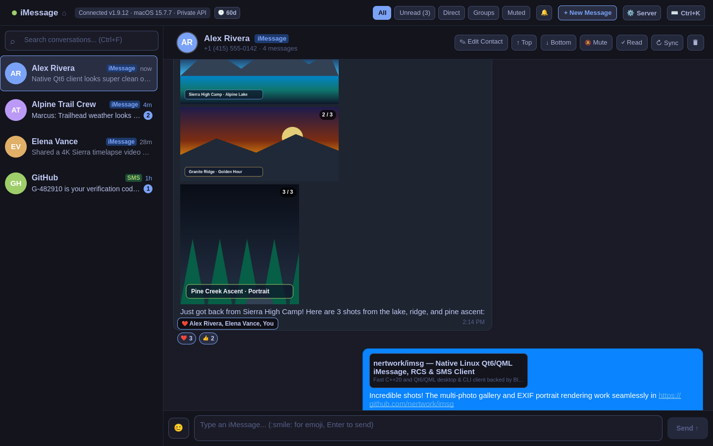
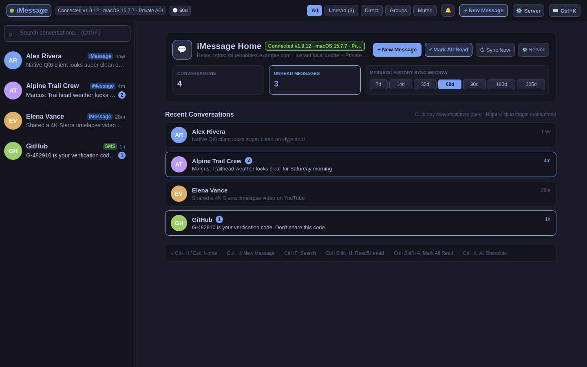
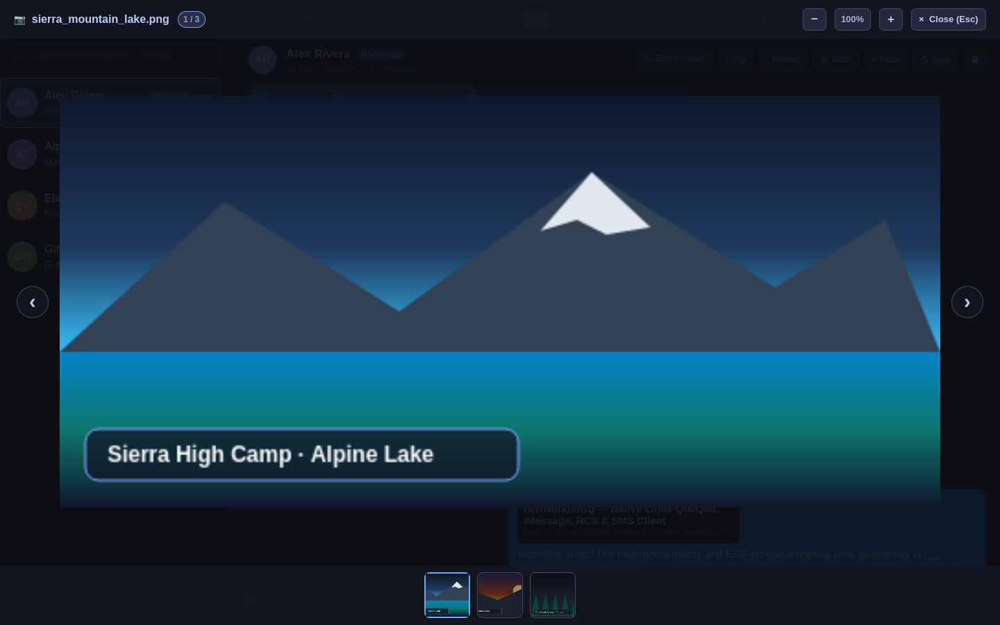
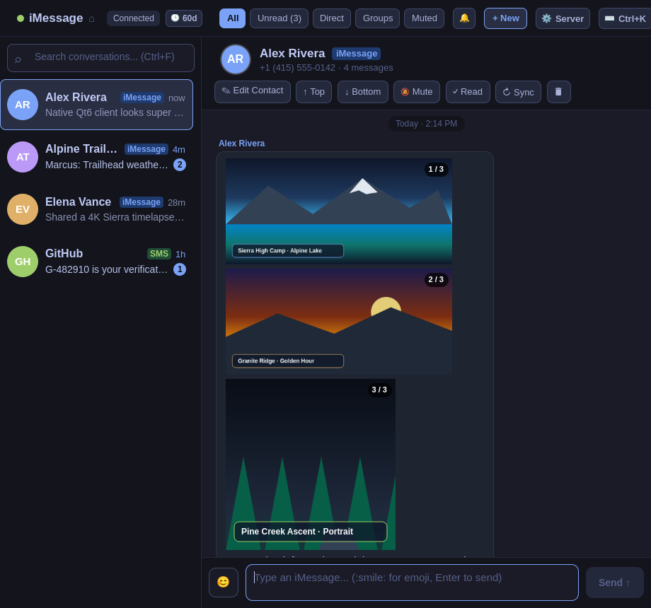

# imsg — Native Linux Qt6/QML iMessage, RCS & SMS Client

[](https://github.com/nertwork/imsg/actions/workflows/ci.yml)
[](https://github.com/nertwork/imsg/releases/latest)
[](LICENSE)
[](https://aur.archlinux.org/packages/imsg)

**`imsg`** is a fast, keyboard-centric, native **C++20 and Qt6/QML** desktop and CLI client for **iMessage**, **RCS**, and **SMS** on Linux (Wayland / Hyprland / Omarchy / X11), backed by a macOS [BlueBubbles](https://bluebubbles.app/) relay server.

Designed as a lightweight (~48 MB RSS), zero-Electron, zero-Flutter replacement for the official desktop client, `imsg` eliminates ObjectBox file-locking crashes, starts in **0ms** from a local JSON state cache, delivers real-time messages via **Socket.IO v4 push + REST delta polling**, and hot-reloads [Omarchy](https://omarchy.org) desktop themes automatically.

---

## Screenshots

### Active Conversation — Multi-Photo Gallery, Tapback Reactions & Rich Link Previews


### iMessage Home Dashboard — Sync Window Presets, Server Setup & Unread Summary


### Built-In Full-Window Photo Lightbox & Gallery Viewer


### Responsive 50% Tiled Split-Window Layout (`920x860`)


---

## Key Features

- **Native C++20 & Qt6/QML Architecture:** Pure Qt Quick Controls 2 UI running natively on Wayland (`qt6-wayland`) and X11 with ~48 MB RSS memory footprint and zero background database lock contention.
- **0ms Local Cache Startup:** Persists conversation metadata, participant graphs, and message timelines in `~/.config/imsg/messages_cache.json` (`0600`) so the full UI renders on frame 1 while delta reconciliation runs asynchronously.
- **Real-Time Socket.IO v4 Push + REST Delta Polling:** Maintains an Engine.IO v4 / Socket.IO v4 long-polling push channel (`new-message`, `updated-message`, `chat-read-status-changed`) paired with a 2.5s REST delta safety poll and 120s delayed-SMS lookback window.
- **4 Isolated `QNetworkAccessManager` Pools:** Strictly separates outgoing message/reaction dispatch (`m_sendNam`), metadata polling (`m_nam`), Socket.IO push (`m_socketNam`), and background attachment downloads (`m_mediaNam`) so heavy photo downloads never block outgoing messages.
- **Full BlueBubbles Private API Support:**
  - Send and receive **iMessage** (blue bubbles), **RCS**, and **SMS** (green bubbles).
  - Interactive **Tapback reactions** (`❤️`, `👍`, `👎`, `😂`, `‼️`, `❓`) with grouped counts, per-sender attribution, and hover tooltips (`❤️ Alex Rivera, Elena Vance, You`).
  - Inline **threaded replies**, **Unsend (`↩`)** across iCloud devices, and **Delete message / conversation (`🗑`)**.
  - **Bidirectional read-state sync** across iPhone, iPad, Mac, and Linux using custom SQLite `message.is_read = 0` queries against macOS Sequoia `chat.db`.
- **Multi-Photo Bubbles & Disguised HEIC Magic-Byte Conversion:** Renders 1..N image attachments per message with `1 / N` gallery badges, EXIF orientation (`autoTransform`), portrait aspect-ratio preservation, background `ftyp` magic-byte detection (`heif-convert` / `magick` to `.heic.jpg` sidecar), and a keyboard-driven full-window lightbox (`←`/`→`, `+`/`-`/`0`, `Esc`).
- **One-Click 2FA / OTP Verification Code Extraction:** Automatically detects 4–8 digit verification codes (including hyphenated `G-482910` and orphan short-code SMS rows without `chat_message_join` entries) and renders a one-click **`Copy Code`** pill.
- **Built-In GUI Server Setup & Automatic Failover:** Configure primary and secondary/failover BlueBubbles relay URLs and API keys directly from the **⚙ Server** modal (`Ctrl+,`) or `~/.config/imsg/config.json`.
- **Live Omarchy Theme Hot-Reload:** Watches `~/.config/omarchy/current/theme/colors.toml` via `QFileSystemWatcher` and updates all surface, accent, selection, and typography tokens in real time.
- **Headless CLI Automation:** Query connection health (`imsg status --json`), list recent messages (`imsg recent --limit 20 --json`), or send messages (`imsg send "+14155550142" "Hello!" --json`) from scripts, Waybar modules, or AI agents.

---

## Quick-Start Installation

### Option 1: Arch Linux (AUR)

```bash
yay -S imsg
# or using paru:
paru -S imsg
```

### Option 2: Build & Install Arch Package from Source (`makepkg`)

```bash
git clone https://github.com/nertwork/imsg.git
cd imsg/pkgbuild
makepkg -si
```

### Option 3: Direct Build from Source (Arch / Fedora / Ubuntu / Debian)

Ensure Qt6 (`qt6-base`, `qt6-declarative`, `qt6-svg`, `qt6-wayland`), `libnotify`, and optionally `libheif` / `imagemagick` are installed:

```bash
git clone https://github.com/nertwork/imsg.git
cd imsg
./bin/build
./bin/test
sudo install -Dm755 build/imsg /usr/bin/imsg
```

To try `imsg` immediately without a BlueBubbles server, launch **Demo Mode**:

```bash
imsg --demo
```

---

## Setting Up Your BlueBubbles macOS Relay

`imsg` connects over HTTPS to a [BlueBubbles Server](https://bluebubbles.app/) running on macOS (either a physical Mac mini / MacBook or a macOS Sequoia VM on Proxmox VE).

See the complete **[BlueBubbles macOS Relay Setup Guide](docs/BLUEBUBBLES_SETUP_GUIDE.md)** for step-by-step instructions covering:
1. Deploying macOS (Physical Mac or Proxmox macOS Sequoia VM).
2. Installing `BlueBubbles.app` and configuring **SIP + Private API (`BlueBubblesHelper.dylib`)** for tapbacks, replies, unsends, and bidirectional read-state sync.
3. Enabling iPhone **Text Message Forwarding** (for SMS/RCS) and **Messages in iCloud**.
4. Preventing macOS Sequoia from auto-deleting 2FA verification codes (`defaults write com.apple.MobileSMS DeleteVerificationCodes -bool false`).
5. Configuring a reverse proxy with TLS (Caddy, Nginx, HAProxy, or Tailscale HTTPS) in front of port `1234`.

---

## Configuration (GUI, JSON & `libsecret`)

### First-Run GUI Setup (`Ctrl+,`)

On first launch (when `~/.config/imsg/config.json` is not yet configured), `imsg` automatically opens the **BlueBubbles Server Configuration** modal (`⚙ Server` button in the top bar or Home dashboard, or `Ctrl+,`):

1. **Primary Server URL:** Your BlueBubbles HTTPS endpoint (e.g., `https://bluebubbles.example.com`).
2. **Failover Server URL (Optional):** Optional secondary/LAN endpoint (e.g., `https://bluebubbles-lan.example.com`).
3. **API Password / Key:** Your BlueBubbles server password.
4. Click **Save & Connect** — credentials are written to `~/.config/imsg/config.json` with strict `0600` (`chmod 600`) owner-only permissions.

### Configuration File (`~/.config/imsg/config.json`)

```json
{
  "serverUrl": "https://bluebubbles.example.com",
  "secondaryServerUrl": "https://backup-relay.example.com",
  "password": "your-bluebubbles-server-password",
  "tlsVerified": true,
  "authMethod": "tls-apikey"
}
```

### Linux Secret Service (`secret-tool` / `libsecret`)

If `"password"` is omitted from `~/.config/imsg/config.json`, `imsg` automatically queries `secret-tool` using the hostname of `serverUrl` or the default `imsg` service:

```bash
secret-tool store --label="BlueBubbles API Key" service bluebubbles account bluebubbles.example.com
# or generic default account:
secret-tool store --label="imsg API Key" service imsg account default
```

See **[Configuration & CLI Reference](docs/CONFIGURATION_AND_CLI.md)** for environment variables (`IMSG_SERVER_URL`, `IMSG_SECONDARY_URL`, `IMSG_PASSWORD`) and `systemd --user` service setup.

---

## Headless CLI Usage

`imsg` includes a zero-GUI headless CLI mode for scripts, status bars, and automation:

```bash
# Check relay connectivity, unread count, and server status
imsg status
imsg status --json

# List the 15 most recent conversations with timestamps and unread counts
imsg recent --limit 15
imsg recent --limit 15 --json

# Send an iMessage / SMS by phone number, email, or chat GUID
imsg send "+14155550142" "Deploying v1.0.0 now!"
imsg send "iMessage;-;+14155550142" "Hello from Linux!" --json
```

---

## Keyboard Shortcuts

| Shortcut | Action |
| :--- | :--- |
| `Ctrl+H` / `Esc` | Open **iMessage Home** dashboard / clear active conversation |
| `Ctrl+,` | Open **BlueBubbles Server Configuration** modal (`⚙ Server`) |
| `Ctrl+N` | Start a **New Message** (with live contact autocomplete) |
| `Ctrl+F` / `/` | Focus conversation search & filter bar |
| `Ctrl+J` / `Ctrl+Down` | Select next conversation in sidebar |
| `Ctrl+P` / `Ctrl+Up` | Select previous conversation in sidebar |
| `Alt+1` .. `Alt+9` | Jump directly to conversation `1`–`9` |
| `Ctrl+R` / `F5` | Trigger immediate delta sync & unread reconciliation |
| `Ctrl+Shift+U` | Toggle active conversation **Read / Unread** in iMessage |
| `Ctrl+Shift+A` | **Mark All Read** across all conversations |
| `Ctrl+M` | Toggle mute for active conversation |
| `Ctrl+D` | Toggle global desktop notifications |
| `PageUp` / `PageDown` | Scroll message timeline up / down by page |
| `Home` / `End` | Jump to top / bottom of message timeline |
| `←` / `→` / `+` / `-` / `0` | Navigate photos and zoom inside the Photo Lightbox Viewer |
| `Ctrl+K` / `?` / `F1` | Open keyboard shortcuts reference modal |
| `Ctrl+Q` | Quit `imsg` |

---

## Documentation Index

- **[BlueBubbles macOS Relay Setup Guide](docs/BLUEBUBBLES_SETUP_GUIDE.md)** — Full macOS relay installation, SIP & Private API helper setup, iPhone SMS forwarding, 2FA code retention, and TLS reverse proxy configuration.
- **[Configuration & CLI Reference](docs/CONFIGURATION_AND_CLI.md)** — GUI & JSON setup, `libsecret` keyring storage, environment variables, Omarchy theme integration, and `systemd --user` service management.
- **[Architecture & Protocol Deep Dive](docs/ARCHITECTURE.md)** — Internal C++20/Qt6 design, 4-pool `QNetworkAccessManager` isolation, Socket.IO v4 state machine, custom SQLite unread reconciliation, and magic-byte HEIC conversion pipeline.

---

## License

Released under the [MIT License](LICENSE).
